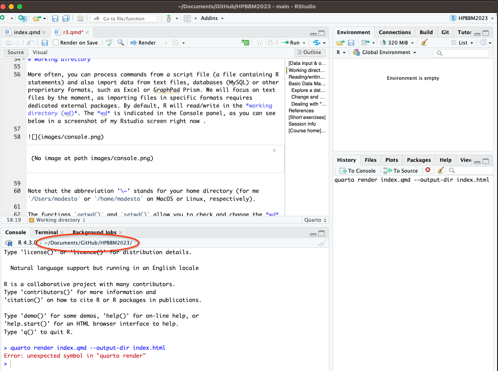
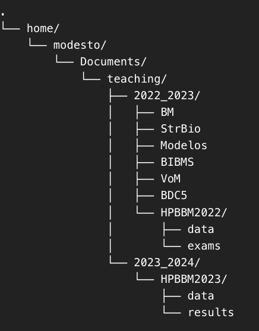



```{r wrap-hook, echo=FALSE}
library(knitr)
library(formatR)
library(webexercises)
opts_chunk$set(tidy=FALSE)

# In RMD/QMD files, the default wd for R code chunks is usually the directory
# that contains the source document. In a Quarto/RStudio Project, try to avoid
# absolute paths tied to one local computer.
# If needed, uncomment and adapt the following line:
# knitr::opts_knit$set(root.dir = normalizePath(".", winslash = "/", mustWork = TRUE))
```

# [Working directory and file paths in R]{style="color:darkblue"}

When working with R, we often need to read data from files and write results back to disk. These files can be simple text files, comma-separated tables, spreadsheet exports (e.g. MS Excel files), or more specialised formats used in biological data analysis.

Before reading or writing files, R needs to know **where to look for them**. By default, R reads and writes files in the current *working directory (wd)*. You can think of the working directory as the folder where R is currently "standing".

The *wd* is indicated in the Console panel, as you can see below in a screenshot of my RStudio screen right now.

{width="545"}

Note that the abbreviation `~` stands for your home directory. For example, this may correspond to `/Users/modesto` in macOS, `/home/modesto` in Linux, or `C:/Users/your_user_name` in Windows.

The functions `getwd()` and `setwd()` allow you to check and change the *wd*. Try the examples below and pay attention to the output. Remember that you can write `?getwd()` or `?setwd()` for help.

::: callout-warning
## File paths in different operating systems

File paths are written differently depending on the operating system. Linux and macOS use forward slashes (`/`), whereas Windows usually displays paths with backslashes (`\`). In R, however, it is safer and simpler to write Windows paths using forward slashes (`/`) or double backslashes (`\\`), because a single backslash has a special meaning inside character strings.

For example, this Windows path:

``` text
C:\Users\Ana\Documents\HPBBM2025\data
```

can be written in R as:

``` r
"C:/Users/Ana/Documents/HPBBM2025/data"
```

or as:

``` r
"C:\\Users\\Ana\\Documents\\HPBBM2025\\data"
```
:::


The following example was generated in a Windows 11 computer. However, unless otherwise indicated, most of the examples and exercises in this site were generated under macOS or Ubuntu and should be adapted if you want to try them out in Windows.

```{r, error=TRUE}
# Windows example
# First, check where R is currently looking for files.
# This is useful before reading or writing any file.
getwd()

# Now we change the working directory to an existing folder.
# Notice that, even in Windows, we use forward slashes (/).
setwd("C:/Users/MR.5052598")
getwd()

# Intentional mistake 1: typo in the folder name.
# "Documnts" does not exist, so setwd() should return an error.
# This is a common source of problems when file paths are typed manually.
setwd("C:/Users/MR.5052598/Documnts")

# Intentional mistake 2: invalid/unwanted character at the end of the path.
# The extra ">" makes the path different from the real folder name.
# This is useful to show that file paths must match exactly.
setwd("C:/Users/MR.5052598/Documents")

# If the previous command worked, this would show the new working directory.
# Since the line above is intentionally wrong, this helps students see that
# the working directory has not changed as expected.
getwd()
```

In RStudio, the *default working directory* can be set from the **Tools \> Global Options** menu. You can also change the *wd* for your session in **Session \> Set Working Directory**, selecting the folder of the source file, the current file location, or a folder selected in the Files panel.

::: callout-tip
## Wouldn't it be great if you didn't have to manually set the working directory every time?

If setting the working directory feels annoying or confusing, you can avoid it by using an [R Project](r7.html#rprojects) in RStudio, as explained in Lesson R7. R Projects automatically manage the working directory for you, making your workflow smoother and more reproducible.
:::

------------------------------------------------------------------------

## [Quick exercise (I): file paths in Windows]{style="color:darkseagreen"}

Imagine that your course data folder is located here in Windows:

``` text
C:\Users\Ana\Documents\HPBBM2025\data
```

Which path is safest and simplest to use in R?

```{r windows-paths, echo = FALSE, results = 'asis'}
opts_p <- c(
  paste0("`", r"(C:\Users\Ana\Documents\HPBBM2025\data)", "`"),
  answer = "`C:/Users/Ana/Documents/HPBBM2025/data`",
  "`C:UsersAnaDocumentsHPBBM2025data`",
  "`/Users/Ana/Documents/HPBBM2025/data`"
)

cat("**Select the right answer**", longmcq(opts_p))
```

------------------------------------------------------------------------

## [Quick exercise (II): working directory]{style="color:darkseagreen"}

Let's see if you understood. Consider the following tree of directories.

{width="279"}

How would you change the *wd* to the folder `HPBBM2023/data`? You can also try this with your own computer and your own directory tree.

```{r wd, echo = FALSE, results = 'asis'}
opts_p <- c(
   "setwd(\"HPBBM2023/data\")",
   answer = "setwd(\"/home/modesto/Documents/teaching/2023_2024/HPBBM2023/data\")",
   "setwd(\"/Users/modesto/teaching/Documents/2023_2024/HPBBM2023/data\")")

cat("**Select the right answer**",longmcq(opts_p))
```

------------------------------------------------------------------------

## [Quick exercise (III): relative paths]{style="color:darkseagreen"}

Suppose your current working directory is:

``` text
HPBBM2025/
```

and inside it you have this folder structure:

``` text
HPBBM2025/
├── data/
│   └── small_matrix.csv
├── scripts/
└── results/
```

Which command reads `small_matrix.csv` without changing the working directory?

```{r relative-paths, echo = FALSE, results = 'asis'}
opts_p <- c(
  'read.table("small_matrix.csv", sep = ",")',
  answer = 'read.table("data/small_matrix.csv", sep = ",")',
  'read.table("../data/small_matrix.csv", sep = ",")',
  'read.table("results/small_matrix.csv", sep = ",")'
)

cat("**Select the right answer**", longmcq(opts_p))
```

------------------------------------------------------------------------

# [Reading & writing data in R]{style="color:darkblue"}

A common first step in data analysis is importing a file into R. In this lesson, we will focus on tabular text files, such as `.txt` or `.csv` files. These files store data in rows and columns, using a separator character to divide the fields.

The base R function `read.table()` is a flexible function for reading tabular data. Several commonly used functions, such as `read.csv()` and `read.csv2()`, are convenient wrappers around `read.table()` with different default options.

For example:

- `read.table()` is general and flexible, but often requires specifying arguments such as `sep`, `header` or `dec`.
- `read.csv()` is designed for comma-separated files, usually using `,` as field separator and `.` as decimal separator.
- `read.csv2()` is common in European spreadsheet exports, usually using `;` as field separator and `,` as decimal separator.


## [Quick exercise (IV): choosing an import function]{style="color:darkseagreen"}

You have a file named `measurements.csv` with the following structure:

``` text
sample,temperature,pH
A,37.0,7.2
B,36.5,7.4
C,38.1,7.1
```

Which function would be the simplest first choice to import this file?

```{r import-function, echo = FALSE, results = 'asis'}
opts <- c(
  "read.csv2()",
  answer = "read.csv()",
  "load()",
  "save()"
)

cat("**Select the right answer**", mcq(opts))
```

## [Quick exercise (V): comma or semicolon?]{style="color:darkseagreen"}

A file exported from a spreadsheet program looks like this:

``` text
sample;temperature;pH
A;37,0;7,2
B;36,5;7,4
C;38,1;7,1
```

Which function is most appropriate as a first attempt?

```{r csv2-function, echo = FALSE, results = 'asis'}
opts <- c(
  "read.csv()",
  answer = "read.csv2()",
  "readLines()",
  "saveRDS()"
)

cat("**Select the right answer**", mcq(opts))
```

------------------------------------------------------------------------

## [Reading data example]{style="color:darkblue"}

In the following example, we read a file called [*small_matrix.csv*](data/small_matrix.csv), located in the [`data`](https://github.com/r4biochemists/r4biochemists.github.io/tree/main/data) folder.

Although the file contains numerical values arranged like a matrix, `read.table()` imports it as a *data frame*. A data frame is a very useful structure for tabular data, but some matrix-specific functions may require explicitly converting it into a matrix with `as.matrix()`.

```{r error=TRUE}

sm <- read.table("small_matrix.csv", sep=",")
# Intentional mistake: we tried to read the file as if it were located
# directly in the working directory.
# However, the file is actually inside the data/ folder.
# This should return an error such as "cannot open the connection".
#
# When a file cannot be found, the first useful diagnostic step is
# to check the working directory.
getwd()

# Correct version: include the relative path from the working directory
# to the file. Here, the file is inside the data/ folder.
sm <- read.table("data/small_matrix.csv", sep=",")

# Print the object to inspect the imported table.
sm

# Important point: read.table() imports tabular data as a data frame,
# even if all values are numeric.
is.matrix(sm)

# Some functions, such as t(), may work because R can coerce the object
# to a matrix when possible.
t(sm)

# Arithmetic operations may also work if all columns are numeric.
sm * 3

# Intentional problem: diag() expects a matrix-like object.
# Depending on the object structure, this may fail or behave unexpectedly.
diag(sm)

# Correct approach: explicitly convert the data frame into a matrix.
diag(as.matrix(sm))

# Same idea with heatmap(): it is a matrix-oriented function.
# The first call is intentionally included to show what happens if we
# pass a data frame directly.
heatmap(sm)

# Correct approach: convert the data frame explicitly.
heatmap(as.matrix(sm))
```

## [Quick exercise (VI): data frame or matrix?]{style="color:darkseagreen"}

After importing a numerical table with `read.table()`, you obtain an object called `sm`.

Which command checks whether `sm` is a matrix?

```{r matrix-check, echo = FALSE, results = 'asis'}
opts <- c(
  "is.data.frame(sm)",
  answer = "is.matrix(sm)",
  "as.matrix(sm)",
  "matrix(sm)"
)

cat("**Select the right answer**", mcq(opts))
```

Which command converts `sm` into a matrix?

```{r matrix-convert, echo = FALSE, results = 'asis'}
opts <- c(
  "is.matrix(sm)",
  "data.frame(sm)",
  answer = "as.matrix(sm)",
  "read.matrix(sm)"
)

cat("**Select the right answer**", mcq(opts))
```

::: callout-tip
Note that `read.table()` and its wrappers `read.csv()` or `read.csv2()` are mostly used for reading data frames. If you want to read text files, like in the case of biological sequences, you can use other functions, such as `readLines()`, described in [Lesson R8](r9.html).
:::

## [Writing tables and saving R objects]{style="color:darkblue"}

Once you have created or modified an object in R, you may want to save it. There are two common situations:

1.  **Saving a table as a text file**, so that it can be opened by other programs.
2.  **Saving R objects**, so that they can be loaded again in R with their structure preserved.

For tables, we can use functions such as `write.table()`, `write.csv()` or `write.csv2()`. For R objects, we can use `save()`, `load()`, `saveRDS()` or `readRDS()`.

You can write any data object as a binary data file or as a text file. Compare the different files saved in the code below.

::: {#save1}
:::

```{r}
# Create two simple example objects.
vector <- c(1:5)
vector2 <- c(3, 5:13)

# write() writes a simple vector to a text file.
# This is useful for simple objects, but not usually the best option
# for complete data frames.
write(vector2,file="data/vector2.txt")

# write.table() writes a tabular object to a text file.
# Intentional issue for discussion: by default, write.table() writes
# row names and column names and uses spaces as separator.
# Open the resulting file and compare it with sm2.csv below.
write.table(sm,"data/sm.csv")

# Here we explicitly control the output:
# - row.names = FALSE avoids saving row numbers as an extra column.
# - col.names = FALSE avoids saving column names.
# - sep = "," creates comma-separated values.
write.table(sm,"data/sm2.csv", row.names = FALSE, col.names=FALSE, sep=",")

# save() stores one or more R objects in a binary RData file.
# When loaded again, the original object names will be restored.
save(vector, vector2,file="data/vector2.Rdata")

# save.image() stores the whole current workspace.
# This is useful to know, but in reproducible analyses it is usually
# better to save scripts and selected objects explicitly.
save.image(file='data/myEnvironment.RData')
```

::: {#load}
:::

Data files in `RData` format can be opened from the *Environment* tab or with the `load()` function. To check that it was correctly loaded, we can remove it before loading with the `rm()` function.

```{r}
# Remove the objects from the Global Environment in our RStudio session.
# This allows us to check whether load() really restores them.
rm(vector)
rm(vector2)

# load() restores the object names that were saved in the RData file.
# Notice that we do not choose new names here.
load("data/vector2.Rdata")

# Check that the objects are available again.
vector
vector2
```

::: callout-caution
Note that if you save your data with `save()`, it cannot be restored under a different name. The original object names are automatically used. If you want to save one object and restore it with a different name, use the functions `saveRDS()` and `readRDS()`.
:::

## [Quick exercise (VII): `save()` or `saveRDS()`?]{style="color:darkseagreen"}

You want to save a single object called `sm`, and later load it under a different name, for example `my_matrix`.

Which pair of functions is most appropriate?

```{r save-vs-rds, echo = FALSE, results = 'asis'}
opts <- c(
  "save() and load()",
  answer = "saveRDS() and readRDS()",
  "write.table() and read.table()",
  "save.image() and load()"
)

cat("**Select the right answer**", mcq(opts))
```

```{r}
# saveRDS() saves a single R object.
# Unlike save(), it does not force us to restore the object with its
# original name.
saveRDS(sm, file = "data/sm.rds")

# readRDS() returns the saved object, so we can assign it to any name.
# Here we deliberately use a new name.
my_matrix <- readRDS("data/sm.rds")
```

------------------------------------------------------------------------

## [Quick exercise (VIII)]{style="color:darkseagreen"}

We are using the same directory tree. Your *wd* is `HPBBM2022/data` and you need to save a data frame named `table1` as `table1.csv` in the folder `HPBBM2023/data` using `;` as separator. How would you do it *without changing* the working directory? Try it also with your own computer.

```{r  echo = FALSE, results = 'asis'}
opts_p <- c(
   answer = "write.table(table1, \"../../../teaching/HPBBM2023/data/table1.csv\", sep=\";\") ",
   "write.table(table1, \"../../HPBBM2023/data/table1.csv\", sep=\";\") ",
   "write.table(table1, \"../../../HPBBM2023/data/table1.csv\")"
)
cat("**Select the right answer**",longmcq(opts_p))
```

------------------------------------------------------------------------

::: callout-note
# Interactive data input & output in R

You will almost always import your working data from a file. However, especially if you are working with very small datasets, it is also possible to add your data interactively directly in the console, as you did in some of the examples before.

You can also define your objects and enter your data interactively using the `scan()` and `readline()` functions, as in the examples below. For output, you can simply call the object by its name or use the `print()` function, which displays the contents of the object on the screen. You can try the following code.[^1]

```{r}
#| echo: true
#| eval: false
# This chunk is not evaluated when the page is rendered because these
# functions require interactive input from the user.

# scan(n = 4) asks the user to enter exactly four values.
vector <- scan(n=4)

# scan() without n keeps reading values until the user stops input.
vector2 <- scan()

# readline() reads one line of text from the console.
str <- readline()

# Calling an object name prints the object.
vector

# print() makes the output explicit. This is useful inside functions
# or scripts where you want to control what is displayed.
print(vector2)
print(str)

# edit() opens an interactive editor for the object.
# This is useful to know, but it is not usually recommended in
# reproducible scripts because manual edits are not recorded as code.
edit(str)
```

Although seldom used, you can also edit the contents of your objects using the function `edit()`. This function can be used to edit different objects, including vectors, strings, matrices or data frames. macOS users may need to install [XQuartz X11](https://www.xquartz.org/) tool.
:::

[^1]: Since it is interactive, we cannot run it when we render the source file into a static web page. This can be prevented in Markdown/Quarto with the option `eval: false` in the chunk.

# [Basic Data Management in R]{style="color:darkblue"}

Now we are going to import and explore an example dataset containing metadata from an Illumina sequencing project of pathogenic *E. coli* strains (Flament-Simon et al. 2020, <https://doi.org/10.1038/s41598-020-69356-6>). However, for didactic purposes, the original data have been simplified and manipulated and the attached datasets do not fully correspond to the actual data.

You can find the table in the [`data`](https://github.com/r4biochemists/r4biochemists.github.io/tree/main/data) folder or download it here: [coli_genomes.csv](data/coli_genomes.csv).

## Open and explore a data frame

As you can see in the R help, the function `read.table()` has several default options, such as `header = FALSE`. When you have a spreadsheet export file where fields are divided by commas or semicolons, you can use `read.csv()` or `read.csv2()` instead of writing all the arguments manually in `read.table()`.

For Spaniards, there is also `read.csv2()`, which uses a comma for the decimal point and a semicolon for the separator. These functions are wrappers of `read.table()` with custom default options. Likewise, there are `write.csv()` and `write.csv2()`, which are wrappers of `write.table()`.

Before analysing a dataset, it is important to inspect it. A quick first exploration usually includes checking:

- the first and last rows,
- the number of rows and columns,
- the variable names,
- the type of each variable,
- whether some values may need cleaning.

The following commands are a useful first checklist when opening a new table in R. They also illustrate several ways to open a table, including some common mistakes.

```{r error=TRUE}
# Note differences between read.table(), read.csv() and read.csv2().

# Intentional mistake / incomplete import:
# read.table() assumes header = FALSE and uses whitespace as separator by default.
# Our file is semicolon-separated and has a header line, so the result will not
# be imported as intended.
coli_genomes <- read.table(file = "data/coli_genomes.csv")
head(coli_genomes)

# Better: here we specify the separator, decimal character and header.
# This is the explicit read.table() version.
coli_genomes <- read.table(file = "data/coli_genomes.csv", sep=";", dec=".", header=TRUE)
head(coli_genomes)

# Intentional mistake / wrong default for this file:
# read.csv() assumes comma-separated values. If the file actually uses semicolons,
# the table will not be split into the expected columns.
coli_genomes <- read.csv(file = "data/coli_genomes.csv")
head(coli_genomes)

# Better than the previous line: we still use read.csv(), but we manually set
# sep = ";". This shows that wrappers can be customised.
coli_genomes <- read.csv(file = "data/coli_genomes.csv", sep=";")
head(coli_genomes)

# Most convenient option for this type of European-style CSV file:
# read.csv2() uses sep = ";" and dec = "," by default.
coli_genomes <- read.csv2(file = "data/coli_genomes.csv")
head(coli_genomes)

# First inspection: show the beginning and the end of the data frame.
head(coli_genomes)
tail(coli_genomes, n=2)

# Indexing examples:
# row 1, all columns
coli_genomes[1,]

# all rows, column 1
coli_genomes[,1]

# rows 1 to 6 and columns 2 to 4
coli_genomes[1:6,2:4]

# Basic dimensions of the data frame.
# dim() returns rows and columns.
dim(coli_genomes)

# For a data frame, length() returns the number of columns, not the number of rows.
# This is a common source of confusion.
length(coli_genomes)

# Explicit alternatives for columns and rows.
ncol(coli_genomes)
nrow(coli_genomes)

# Data frame structure in one line.
# str() is often the fastest way to detect wrong imports.
str(coli_genomes)

# Type of data in selected variables.
# Notice that selecting a column with $ and selecting with [, ] may differ
# depending on whether the result is simplified to a vector or kept as a data frame.
typeof(coli_genomes$Strain)
typeof(coli_genomes[,2])
typeof(coli_genomes[,9])

# Column and row names.
names(coli_genomes)
colnames(coli_genomes)
rownames(coli_genomes)

# Three ways to rename the third variable are shown for comparison.
# The second option is usually the clearest when renaming one column.
names(coli_genomes[3]) <- 'Year'
names(coli_genomes)[3] <- 'Year'
colnames(coli_genomes[3]) <- 'Year'
```

## [Quick exercise (IX): exploring a data frame]{style="color:darkseagreen"}

You have imported a data frame called `coli_genomes`.

Which command shows the first rows of the data frame?

```{r explore-head, echo = FALSE, results = 'asis'}
opts <- c(
  "tail(coli_genomes)",
  answer = "head(coli_genomes)",
  "dim(coli_genomes)",
  "names(coli_genomes)"
)

cat("**Select the right answer**", mcq(opts))
```

Which command shows the number of rows and columns?

```{r explore-dim, echo = FALSE, results = 'asis'}
opts <- c(
  "length(coli_genomes)",
  answer = "dim(coli_genomes)",
  "typeof(coli_genomes)",
  "rownames(coli_genomes)"
)

cat("**Select the right answer**", mcq(opts))
```

Which command gives a compact summary of the structure of the data frame?

```{r explore-str, echo = FALSE, results = 'asis'}
opts <- c(
  "summary.names(coli_genomes)",
  "table(coli_genomes)",
  answer = "str(coli_genomes)",
  "levels(coli_genomes)"
)

cat("**Select the right answer**", mcq(opts))
```

Some of the columns include character data that may actually represent categorical variables, so we can encode them as **factors**. Using the function `as.factor()`, you can convert a character vector into a categorical variable.

```{r}
# Some character variables actually represent categories.
# Converting them to factors helps R treat them as categorical variables.
coli_genomes$Source <- as.factor(coli_genomes$Source)
coli_genomes$Phylogroup <- as.factor(coli_genomes$Phylogroup)

# Check that the structure has changed.
str(coli_genomes) # data frame structure updated
```

How many levels are there in *Source*? It is not uncommon to find mistakes in our data, usually made when the data were recorded. For example, a space may have been inserted before a value. By default, this white space will be kept in the R environment, so `'Human'` will be recognised as a different value from `' Human'`. To avoid this type of error, we can use the `strip.white` argument.

```{r}
# unique() shows the different values found in the variable.
# Intentional data-cleaning issue: if one value has an extra leading or trailing
# space, R will treat it as a different category.
unique(coli_genomes$Source)

# table() counts how many observations belong to each category.
table(coli_genomes$Source)

# Re-import the file using strip.white = TRUE.
# This removes leading/trailing spaces in unquoted character fields.
coli_genomes <- read.csv2(file = "data/coli_genomes.csv",  strip.white = TRUE)

# Convert again to factors after re-importing.
coli_genomes$Source <- as.factor(coli_genomes$Source)
coli_genomes$Phylogroup <- as.factor(coli_genomes$Phylogroup)

# Check whether the apparent extra categories disappeared.
unique(coli_genomes$Source)
```

## [Quick exercise (X): complete the code]{style="color:darkseagreen"}

Complete the following code to import `coli_genomes.csv` from the `data` folder using `read.csv2()` and remove extra white spaces.

```{webr}
#| exercise: ex_read_coli
coli_genomes <- ____(file = "____", strip.white = ____)
head(coli_genomes)
```

At this point, you may consider that writing the name of the data frame every time that you want to work with it can be repetitive. In fact, we don't need to do it.

```{r}
# attach() makes the columns of coli_genomes available by name.
# This allows us to write Source instead of coli_genomes$Source.
attach(coli_genomes) # attach

# This works because Source is now found in the attached data frame.
table(Source)

# Always detach when you finish, otherwise attached objects may remain
# in the search path and create confusing results later.
detach(coli_genomes)
```

Note that `attach()` can be used for any R object, including data frames, lists, vectors and packages. Once attached, R will consider those objects as databases, located in new, temporary environments.

::: callout-warning
## Be careful with `attach()`

The function `attach()` can make column names directly available, so you can write `table(Source)` instead of `table(coli_genomes$Source)`. However, it can also make your code less explicit and may lead to confusion if different objects have variables with the same name.

For this reason, in most scripts it is safer to use the explicit form:

``` r
table(coli_genomes$Source)
```

rather than relying on `attach()`.
:::

::: {.callout-tip title="Throw out the trash"}
If you want to remove some data to free up your computer's memory, you can use the `rm()` function (aka `remove()`) to remove a specific object from your working environment. If you are running a script with large datasets, you can also use `gc()` to free memory after a large object has been removed. This is also done automatically without the user having to intervene, but it can be useful to call `gc()` after a large object has been removed, as this can prompt R to return memory to the operating system.
:::

## Renaming, changing and adding variables

We can also rename some variables to use easier names.

```{r}
# First check all variable names.
# This helps us identify the position of the columns we want to rename.
names(coli_genomes) # see all variable names

# Rename variables by position.
# This is quick, but it requires being sure that the column order is correct.
names(coli_genomes)[3] <- 'Year'
names(coli_genomes)[10] <- 'Plasmids'
names(coli_genomes)[c(15,16)] <- c('Assembly_length','contigs1kb')

# Check that the new names were applied correctly.
names(coli_genomes)
```

We are going to simplify our data frame by dropping one or more variables (columns):

```{r}
# Show the data frame without column 12.
# Important: this line prints the modified view, but does not overwrite
# coli_genomes because we do not assign the result to an object.
coli_genomes[,-12]

# This can also be used to remove rows (cases).
# Here we do assign the result back to coli_genomes, so rows 9 to 11
# are actually removed from the object.
coli_genomes <- coli_genomes[-c(9:11),]
```

We know the `Assembly_length` and the number of `Contigs`, but we would like to represent the average contig length.

```{r}
# Create a new variable using existing columns.
# The $ operator selects or creates a column in a data frame.
coli_genomes$average_contig <- coli_genomes$Assembly_length / coli_genomes$Contigs
```

::: callout-note
If you need more tips on handling tables in R, such as sorting, subsetting, or quick data merging by common variable(s), see Lesson [R6](r6.html).
:::

## Dealing with *NAs*

Real datasets often contain missing values. In R, missing values are represented as `NA`, which means "not available".

Missing values affect many calculations. For example, if a vector contains at least one `NA`, functions such as `mean()` will usually return `NA` unless we explicitly ask R to remove missing values.

Imagine we want to know the average year of sample isolation.

```{r}
# Intentional issue: if Year contains at least one NA, mean() returns NA.
# This is not an error; it is R telling us that the result is unknown
# because some values are missing.
mean(coli_genomes$Year)
```

As you may have guessed, the `NA` output means that there are some missing values and the mean cannot be calculated directly. We can check that and omit the `NA` values.

```{r}
# Check for NA values in the whole data frame.
# This returns a logical table with TRUE where values are missing.
is.na(coli_genomes)

# Count missing and non-missing values in the complete data frame.
table(is.na(coli_genomes))

# Alternative: check complete rows.
# TRUE means that the row has no missing values.
# FALSE indicates an incomplete observation.
complete.cases(coli_genomes)

# na.rm = TRUE tells mean() to remove missing values before calculating.
# This argument is common in many summary functions.
mean(coli_genomes$Year, na.rm=TRUE)
```

What if we want to remove observations with an `NA` from the whole table?

```{r}
# Create a new data frame without incomplete rows.
# Be careful: na.omit() removes any row with at least one NA in any column.
coli_genomes2 <- na.omit(coli_genomes)

# Now the mean can be calculated without na.rm = TRUE because the rows
# containing missing values have been removed.
mean(coli_genomes2$Year)
```

In fact, you can use `na.omit()` for any object, either a vector, data frame or list.

## [Quick exercise (XI): missing values]{style="color:darkseagreen"}

You want to calculate the mean of the variable `Year`, ignoring missing values.

Which command is correct?

```{r na-mean, echo = FALSE, results = 'asis'}
opts <- c(
  "mean(coli_genomes\\$Year)",
  "mean(coli_genomes\\$Year, remove.na = TRUE)",
  answer = "mean(coli_genomes\\$Year, na.rm = TRUE)",
  "mean(coli_genomes\\$Year, omit = TRUE)"
)

cat("**Select the right answer**", mcq(opts))
```


Which command creates a new data frame without incomplete rows?

```{r na-omit, echo = FALSE, results = 'asis'}
opts <- c(
  "remove.na(coli_genomes)",
  "complete.cases(coli_genomes)",
  answer = "na.omit(coli_genomes)",
  "is.na(coli_genomes)"
)

cat("**Select the right answer**", mcq(opts))
```

Note that `mean(na.omit(coli_genomes$Year))` would also work for the first question. However, `na.rm = TRUE` is the usual and most direct way to ignore missing values inside functions such as `mean()`. However, you should be careful with `na.omit(coli_genomes)`, because it removes complete rows with missing values in *any* column.

## [Quick exercise (XII)]{style="color:darkseagreen"}

Now, we need to save the current version of [`coli_genomes`](https://r4biochemists.github.io/data/coli_genomes.csv) in the data folder, using `,` as field separator.

```{r  echo = FALSE, results = 'asis'}
opts <- c("write.table",
            "write.csv2",
            answer = "write.csv",
            "save")
q1 <- mcq(opts)
cat("Which of the following functions can you use to save the dataframe using `,` as field separator?", q1)
```

How would you do it?

```{r  echo = FALSE, results = 'asis'}
opts_p <- c(
   answer = "write.table(coli_genomes, \"data/coli_genomes_renamed.csv\", sep=\",\" )",
   "write.csv2(coli_genomes, \"data/coli_genomes_renamed.csv\" )",
   "write.csv(coli_genomes, \"../coli_genomes_renamed.csv\") ",
    answer = "write.csv(coli_genomes, \"data/coli_genomes_renamed.csv\")")
cat("**Select the right answer**",longmcq(opts_p))
```

::: {#save}
:::

Finally, save the new dataset in your folder for future examples.

```{r}
# Save the cleaned/modified table for future lessons.
# row.names = FALSE avoids writing row numbers as an extra first column.
write.csv(coli_genomes,"data/coli_genomes_renamed.csv", row.names=FALSE)
```

## [Quick exercise (XIII)]{style="color:darkseagreen"}

R has some built-in datasets that can be used as examples for plots or analysis. You can check all of them using the function `data()`. For the following exercise we are going to use one of those datasets, named *quakes*. You can import it as follows:

```{r eval=FALSE}
# data() loads built-in datasets available in R packages.
# Here we load the built-in quakes data frame.
data(quakes)
```

Then, use the function `str()` to examine the structure of the *quakes* dataset. Which of the following best describes the variables represented in this data frame?

```{r  echo = FALSE, results = 'asis'}
opts_p <- c(
   answer = "Location and characteristics of earthquakes off Fiji",
   "Glass vibration during Eurovision contest",
   "Fever and seizures due to mPox")
cat("**Select the right answer**",longmcq(opts_p))
```

Now you need to create a new dataframe *quakes2* with the three columns, *lat*, *long* and *new_var*, the latter being the product *lat* $x$ *long*. What is the mean of the new variable? Fill the gaps to finish your code in the R snippet below.

```{webr}
#| exercise: ex_1_r
data(quakes)
quakes2 <- data.frame(____, ____, ____)
names(quakes2) #confirm the column names
____(quakes2[,3])
```

------------------------------------------------------------------------

# References

- *An introduction to R*, <https://intro2r.com/work-d.html>
- *R programming for data science*, <https://bookdown.org/rdpeng/rprogdatascience/>
- Using RStudio projects, <https://support.rstudio.com/hc/en-us/articles/200526207>
- Importar y exportar datos en R, <https://rsanchezs.gitbooks.io/rprogramming/content/chapter3/index.html>
- *R in action.* Robert I. Kabacoff. March 2022 ISBN 9781617296055
- R para análisis científicos reproducibles. Software Carpentry Foundation. <https://swcarpentry.github.io/r-novice-gapminder-es/>


# [Review exercises]{style="color:darkgreen"}

In this review exercise, you will import, inspect, debug and save a dataset related to *E. coli* genomes. The goal is not only to obtain the correct numerical results, but also to understand what can go wrong when importing and analysing data in R.

1. Load the file [*colis3.csv*](https://r4biochemists.github.io/data/colis3.csv) as an object named `colis`.

2. Explore the dataset using at least the following functions:

```r
head()
tail()
dim()
names()
str()
```

Check whether the import worked as expected. In particular, answer the following questions:

   - Are the columns separated correctly?
   - Are numerical variables imported as numbers?
   - Are date-like variables imported as dates or as character strings?
   - Are there any unexpected column names or values?

3. Check whether the following code works as expected. If it does not, explain the problem and correct it:

```r
mean(colis$Year)
```

4. Check whether the following code works as expected. If it does not, explain the problem and correct it:

```r
mean(colis$seqs)
```

5. The variable `seqs` contains sequencing dates. Convert it into a date object using `as.Date()` and check the structure of the dataset again.

6. Calculate the mean of the following variables, ignoring missing values when necessary:

```r
Year
AMR
Vir
CRISPR
Integron
```

7. Create a small summary table containing the name of each variable and the corresponding mean value.

   The table should have at least two columns:

```text
Variable
Mean
```

8. Check how many missing values are present in each column of `colis`.

9. Create a copy of the dataset named `colis_no_na` after removing incomplete observations.

10. Compare the number of rows in `colis` and `colis_no_na`. How many rows were removed?

11. Save `colis` and `colis_no_na` together in a single file named `review_R3.RData`.

13. Save the summary table as `review_R3_summary.csv` in the `data/` folder. Make sure that row names are not written as an extra column.

14. Add short comments to your script explaining:

    - which lines import data,
    - which lines check the data structure,
    - which lines clean or transform data,
    - which lines calculate summary values,
    - which lines save results.


# [Extra (short) exercises]{style="color:darkgreen"}

**Want more?** Try the input/output examples from *Techvidvan* website: <https://techvidvan.com/tutorials/r-input-and-output-functions/>

# Session Info

```{r}
sessionInfo()
```
