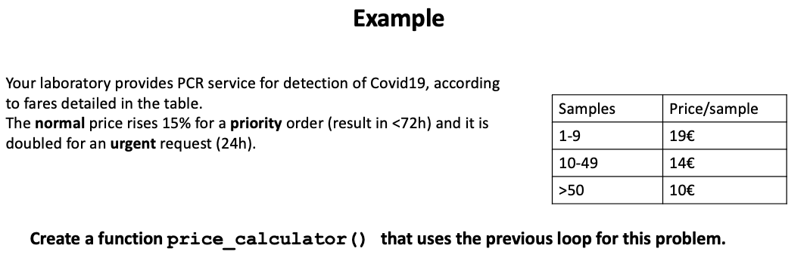



```{r wrap-hook, echo=FALSE}
library(knitr)
library(formatR)
library(webexercises)

# Keep code chunks as written in the .qmd file.
opts_chunk$set(tidy = FALSE)

# In RMD/QMD files, the default wd for R code chunks is usually the directory
# that contains the source document. In a Quarto/RStudio Project, try to avoid
# absolute paths tied to one local computer.
# If needed, uncomment and adapt the following line:
# knitr::opts_knit$set(root.dir = normalizePath(".", winslash = "/", mustWork = TRUE))
```

# [R packages]{style="color:darkblue"}

As you already know, R is a [GNU Software](https://en.wikipedia.org/wiki/GNU) project with a [GPL](https://en.wikipedia.org/wiki/GNU_General_Public_License) license. Because R is freely available and widely used, a large community of users has developed many extensions called ***R packages***.

The basic idea behind packages is simple: if many people need to solve similar problems, it is useful to collect the relevant functions, documentation, examples and data in a reusable unit. When you install a package, you add new functions or datasets to your R installation.

::: callout-important
## What is an R package?

Packages are the basic units of reusable and reproducible R code. They can contain:

- R functions,
- documentation and help pages,
- example datasets,
- tests,
- vignettes or practical tutorials,
- compiled code or external dependencies in some cases.

With RStudio, you can also create your own packages to organise and reuse frequent analyses. This is beyond the scope of this course, but it is important to know that packages are not only something you download: they are also a way of organising your own code.
:::

Packages can be installed from public R repositories. In this course we will mainly refer to two repositories: [**CRAN**](https://cran.r-project.org/) and [**Bioconductor**](https://www.bioconductor.org/).

CRAN stands for *Comprehensive R Archive Network* and contains a large collection of packages that can be used free of charge. You can find the complete list of CRAN packages [by name](https://cran.r-project.org/web/packages/available_packages_by_name.html) or grouped by broad topic in the [CRAN Task Views](https://cran.r-project.org/web/views/).

As we will see in more detail later in [Lesson R8](r9.html), Bioconductor is a repository focused on bioinformatics and computational biology applications.

::: callout-warning
## Packages can change over time

Packages in CRAN and Bioconductor are reviewed, but they may change, become archived, or stop working after updates in R, RStudio or external software. You can also find packages on GitHub, GitLab, Bitbucket or other repositories, but these packages may be less stable or less carefully reviewed.

In this course, try to install packages from CRAN or Bioconductor unless there is a clear reason to do otherwise.
:::

## [Installing and loading R packages]{style="color:darkblue"}

Installing a package and loading a package are different operations:

- `install.packages()` downloads and installs the package in your computer.
- `library()` loads an installed package into the current R session.

You normally install a package only once, but you need to load it again in each new R session before using its functions.

As an example, we could install the package `xlsx`, which can be used to import and export Excel files. However, this package may require Java in some computers, so it is useful as a teaching example of package requirements.

```{r, echo=TRUE, eval=FALSE}
# Install the package from CRAN.
# This only needs to be done once in your computer.
install.packages("xlsx", repos = "https://cran.rstudio.com/")

# CRAN is the default repository in many R installations,
# but it can also be indicated explicitly with repos =.
```

::: callout-caution
## Package requirements

Some packages have additional system requirements outside R or RStudio. For example, packages that read Excel files may depend on Java or other external libraries. If a package fails to install or load, the problem may not be your code: it may be an external dependency.

After testing with students, we found that `xlsx` may require the path of your Java executable. For routine Excel import/export, simpler alternatives such as [`openxlsx`](https://cran.r-project.org/web/packages/openxlsx/index.html) or [`readxl`](https://cran.r-project.org/web/packages/readxl/index.html) are often easier to use.
:::

You must load a package before using its functions directly. There are two common ways to load an installed package: `library()` and `require()`.

```{r, error=TRUE}
# Two ways of loading a package:

# 1. library() loads the package or returns an error if it cannot be loaded.
library(xlsx)

# 2. require() tries to load the package and returns TRUE or FALSE.
# It usually gives a warning rather than stopping immediately with an error.
require(xlsx)

# Open the help page for the package, if it is available.
help(xlsx)

# You can also search help pages from the console with:
# ??xlsx

# A common pattern is to install a package only if it is not already available.
# This is useful in personal scripts, but in teaching materials it may be better
# to ask students to install packages explicitly before class.
if(!require(xlsx)){
    install.packages("xlsx")
    library(xlsx)
}

# Optionally, unload the package from memory.
# This is not usually needed in short scripts, but it can be useful
# when testing package conflicts.
detach("package:xlsx", unload=TRUE)
```

::: callout-note
## `library()` versus `require()`

`library()` and `require()` are often used for similar purposes, but they behave differently when a package cannot be loaded.

- `library(pkg)` is usually preferred in scripts because it clearly fails if the package is missing.
- `require(pkg)` returns `TRUE` or `FALSE`, which makes it useful inside conditional statements.

For beginners, a good rule is: use `library()` when you simply want to load a package; use `require()` only when you need to test whether loading succeeded.
:::

In the following example, we try to load a package called `uam`, which is not expected to exist. Compare the behaviour of `library()` and `require()`.

```{r, error=TRUE}
# Intentional error: this package is not installed and probably does not exist.
# library() stops with an error.
library(uam)

# require() gives a warning and returns FALSE, which can be used in an IF statement.
require(uam)
```

## [Quick exercise (I): installing and loading packages]{style="color:darkseagreen"}

Which command installs a package called `report` from CRAN?

```{r q-install-package, echo = FALSE, results = 'asis'}
opts <- c(
  "library(report)",
  answer = "install.packages(\"report\")",
  "require(report)",
  "browseVignettes(\"report\")"
)
cat("**Select the right answer**", mcq(opts))
```

Which command loads an already installed package called `report`?

```{r q-load-package, echo = FALSE, results = 'asis'}
opts <- c(
  "install.packages(\"report\")",
  answer = "library(report)",
  "remove.packages(\"report\")",
  "vignette(\"report\")"
)
cat("**Select the right answer**", mcq(opts))
```

## [Namespace notation: `package::function()`]{style="color:darkblue"}

Sometimes you may want to use a function from a package without loading the entire package with `library()`. You can do this with the `package::function()` syntax.

This is also useful when two different packages contain functions with the same name. In that case, the namespace prefix makes your code explicit.

```{r error=TRUE, eval=FALSE}
# Example: install a small package from CRAN.
# This chunk is not evaluated when rendering because it installs software.
install.packages("getwiki")

# Open the vignette, if available.
vignette("getwiki")

# Use one function from the getwiki package without loading the package.
DNA <- getwiki::search_wiki("DNA")
str(DNA)
DNA$titles
```


The syntax `package::function()` makes the origin of a function explicit. This is useful in scripts, reports and teaching materials, especially when a function name may exist in more than one package.

In the examples below, we use the `ggplot()` function from the `ggplot2` package. Given the complex syntax of this package (see lesson [R5](r5.html)), this syntax does not look very convenient in this case. A complete plot requires several functions, not only `ggplot()`. This means that using `package::function()` only once may not be enough.

::: {#ggplot}
:::

```{r error=TRUE}
# Example using the built-in iris dataset.
# No need to load iris: it is already available as a built-in dataset.

# Option 1: no package loaded and no namespace prefix.
# Intentional error: ggplot() and aes() are not available unless ggplot2 is loaded
# or we use the ggplot2:: prefix.
ggplot(iris, aes(Petal.Length, Petal.Width, colour = Species)) +
    geom_point()

# Option 2: prefix only ggplot().
# Intentional problem: aes() and geom_point() are still not explicitly found.
ggplot2::ggplot(iris, aes(Petal.Length, Petal.Width, colour = Species)) +
    geom_point()

# Option 3: prefix all ggplot2 functions.
# This is explicit and works without library(ggplot2).
ggplot2::ggplot(iris, ggplot2::aes(Petal.Length, Petal.Width, colour = Species)) +
    ggplot2::geom_point()

# Option 4: load the package and then use the functions directly.
library(ggplot2)
ggplot(iris, aes(Petal.Length, Petal.Width, colour = Species)) +
    geom_point()
```

Note that `iris` is a built-in R dataset. As we mentioned in [Lesson R3](r3.html), R has some built-in datasets that can be used as examples for plots or analysis. You can check all of them using the function `data()`.

## [Quick exercise (II): namespace notation]{style="color:darkseagreen"}

You want to call the function `geom_point()` from `ggplot2` without loading the whole package. Which command uses the correct namespace notation?

```{r q-namespace, echo = FALSE, results = 'asis'}
opts <- c(
  "ggplot2$geom_point()",
  "ggplot2:geom_point()",
  answer = "ggplot2::geom_point()",
  "library(ggplot2::geom_point)"
)
cat("**Select the right answer**", mcq(opts))
```

## [Vignettes and official documentation]{style="color:darkblue"}

Many CRAN packages include a reference manual, and some also include one or more *vignettes*. A vignette is a practical guide to a package. You can see the installed vignettes with `browseVignettes()` or open a specific vignette with `vignette()`.

```{r, error=TRUE}
# Browse installed vignettes for selected packages.
# Some packages may not have vignettes installed on your system.
browseVignettes("xlsx")
browseVignettes("seqinr")
browseVignettes("ggplot2")
```

Note that in some cases there may be no official vignette at CRAN. However, as R is an open language, you will often find information about packages or functions in websites such as [rdrr.io](https://rdrr.io/), [RDocumentation](https://www.rdocumentation.org/) or [Stack Overflow](https://stackoverflow.com/). Try to distinguish official documentation from user-contributed answers.

## [Too many packages]{style="color:darkblue"}

As there are many packages, it sometimes takes time to test different packages for the same analysis. Also, quite often, some packages become obsolete after a new R or RStudio version. Thus, it is also useful to know how to uninstall packages with `remove.packages()`.

```{r, eval=FALSE}
# Remove a package from your R library.
# Do this only if you are sure you do not need it anymore.
remove.packages("xlsx")
```

::: callout-note
## Package "hygiene"

A reproducible script should make clear which packages are required. At the beginning of a script, load the packages you need with `library()`. Avoid loading many packages “just in case”, because this can make scripts slower, less clear and more prone to function-name conflicts.
:::

## [Quick exercise (III): package conflicts]{style="color:darkseagreen"}

You are reading a script and find this line:

``` r
dplyr::filter(my_table, value > 10)
```

What is the main advantage of using `dplyr::filter()` instead of just `filter()`?

```{r q-conflict, echo = FALSE, results = 'asis'}
opts <- c(
  "It installs dplyr automatically.",
  "It makes the code run without R.",
  answer = "It makes explicit that filter() comes from dplyr and not other packages.",
  "It saves the output to a file."
)
cat("**Select the right answer**", mcq(opts))
```

# [Create user-written functions]{style="color:darkblue"}

## Why create functions?

Throughout the previous lessons, we have seen how R can help us save time when analysing and plotting experimental data. However, many analyses involve repeating the same sequence of operations many times, sometimes with slightly different inputs.

Creating your own functions is useful because it allows you to:

- automate repetitive analyses,
- make your scripts shorter and easier to read,
- reduce copy-paste errors,
- test one small part of your code at a time,
- reuse code in future projects,
- separate complex workflows into smaller steps.

**In R, functions are also objects.** This means that functions can be assigned to names, passed as arguments, returned by other functions, or used inside other functions. We will see useful examples of this in [Lesson R6](r6.html), for example with `aggregate()`, `lapply()` or `sapply()`.

The general structure of an R function is:

``` text
my_function <- function(argument1, argument2, ...){
  statements
  return(object)
}
```

A function usually has:

- a name,
- one or more arguments,
- a body containing the instructions,
- an output, often returned with `return()`.

::: callout-tip
## Design rule for beginners

Before writing a function, ask yourself:

1.  What information does the function need?
2.  What steps should it perform?
3.  What should it return?
4.  What could go wrong with the input?
:::

## My first simple functions

A simple function can help us repeat a calculation without copying the same expression many times.

```{r}
# My first function.
# The function receives one argument, x.
# It calculates a value called f and returns it.
myFunction <-  function(x){
  f <- x^2 * 4 + x/3
  return(f)
}

# Test the function with several inputs.
myFunction(4)
myFunction(0)
myFunction(22)
myFunction(3)
```

In the previous example, `x` is a local variable. It only exists inside the function while the function is running.

## [Quick exercise (IV): predict the output]{style="color:darkseagreen"}

Consider this function:

``` r
myFunction <- function(x){
  f <- x^2 * 4 + x/3
  return(f)
}
```

What is the output of `myFunction(0)`?

```{r q-myfunction-output, echo = FALSE, results = 'asis'}
opts <- c(
  answer = "0",
  "1",
  "4",
  "NA"
)
cat("**Select the right answer**", mcq(opts))
```

## Conditions inside functions

We can include conditions, loops and any other R expressions inside a function. The next example checks whether a number is even or odd.

```{r}
# A simple R function to check whether x is even or odd.
evenOdd <- function(x){
  # The operator %% returns the remainder of a division.
  # If x %% 2 is 0, the number is divisible by 2.
  if(x %% 2 == 0){
    return("even")
  } else {
    return("odd")
  }
}

# Test the function.
evenOdd(4)
evenOdd(3)
```

You may sometimes see one-line `if` statements without curly braces. They can work, but they are easier to misread or break when the code grows. In teaching materials and scripts, curly braces are usually safer.

```{r}
# Same idea, but written without curly braces.
# This is shorter, but it can be riskier for beginners.
evenOdd2 <- function(x){
  if(x %% 2 == 0)
    return("even")
  else
    return("odd")
}

evenOdd2(4)
evenOdd2(3)
evenOdd2(7)
evenOdd2(8)
```


## Inline functions

There is also a quick way to write a function, for small ones or functions that we will use only once, for example when passing it as an argument to another function. In those cases, we can write a short inline function.

```{r}
# Inline function: the body is a single expression.
f <- function(x) x^2 * 4 + x/3

f(4)
f(0)
f(22)
```

## [Quick exercise (V): inline function]{style="color:darkseagreen"}

We want to write an inline function that transforms concentrations from millimolar (mM) to micromolar (µM). How would you do it?

```{r wd2, echo = FALSE, results = 'asis'}
opts_p <- c(
   "f <- function(x) 1000",
   answer = "f <- function(x) x * 1000",
   "f <- function(x) x 1000",
   "f <- function(x) x / 1000"
)
cat("**Select the right answer**",longmcq(opts_p))
```

A slightly harder check: what should `f(0.25)` return if `f` converts mM to µM?

```{r q-mM-uM-output, echo = FALSE, results = 'asis'}
opts <- c(
  "0.00025",
  "0.25",
  answer = "250",
  "2500"
)
cat("**Select the right answer**", mcq(opts))
```

------------------------------------------------------------------------

## Functions with multiple arguments

A function can receive more than one input. The next function calculates the area of a rectangle and prints a formatted message.

```{r}
# A simple R function to calculate the area of a rectangle.
area <- function(length, width){
  # Calculate the area.
  area <- length * width

  # Print a formatted message.
  # paste() combines text and values into one character string.
  print(paste("The area of the rectangle is", length, "x", width, "=", area, "cm²"))
}

# Call the function.
area(2, 3)
```

Printing a message is not the same as returning an object. If you want to reuse the result later, it is usually better to return it.

```{r}
# Now we calculate area and perimeter of a rectangle.
Rectangle <- function(length, width){
  area <- length * width
  perimeter <- 2 * (length + width)

  # Create a list containing both results.
  result <- list("Area" = area, "Perimeter" = perimeter)

  # Return the list so it can be stored and reused.
  return(result)
}

Rectangle(2, 3)
```

Like in any R function, you can call the arguments by position or by name. You can also define default values.

```{r}
# Function with default values.
Rectangle <- function(length = 5, width = 4){
  area <- length * width
  return(area)
}

# Case 1: arguments by position.
Rectangle(2, 3)

# Case 2: arguments by name.
# When arguments are named, their order can be changed.
Rectangle(width = 8, length = 4)

# Case 3: default values.
# If no values are provided, length = 5 and width = 4 are used.
Rectangle()
```

## [Quick exercise (VI): arguments by position and by name]{style="color:darkseagreen"}

Consider this function:

```{r, eval=F,echo=T} 
Rectangle <- function(length = 5, width = 4){
  length * width
}
```

What is the output of `Rectangle(width = 8, length = 4)`?

```{r q-rectangle-named, echo = FALSE, results = 'asis'}
opts <- c(
  "12",
  "20",
  answer = "32",
  "40"
)
cat("**Select the right answer**", mcq(opts))
```

What is the output of `Rectangle()`?

```{r q-rectangle-default, echo = FALSE, results = 'asis'}
opts <- c(
  "0",
  "9",
  answer = "20",
  "An error"
)
cat("**Select the right answer**", mcq(opts))
```

## [Quick exercise (VII): dilution function]{style="color:darkseagreen"}

Now, we want a function that helps us with a basic chemistry calculation that you have probably used many times:

$$C_{1} \cdot V_{1} = C_{2} \cdot V_{2}$$

Write a function named *dilution* that returns $V_{1}$, given $C_{1}$, $C_{2}$ and $V_{2}$. Test it with an example in which you have a concentrated NaCl solution of 250 mM and you need to prepare 10 mL of buffer containing 10 mM NaCl. How much NaCl stock do you need?

```{webr-r}
# Write your function here.
# Hint: V1 = (C2 * V2) / C1

# Try it.
dilution(250, 10, 10)
```

A possible answer is:

```{r, echo = TRUE, eval = FALSE, webex.hide = "See an answer"}
# C1: stock concentration
# C2: final concentration
# V2: final volume
# The function returns V1: the volume of stock solution needed.
dilution <- function(C1, C2, V2){
  V1 <- (C2 * V2) / C1
  return(V1)
}

dilution(250, 10, 10)
```

# [Including checkpoints]{style="color:darkblue"}

When we write functions, we should not only think about what happens when users provide correct input. We also need to think about wrong, unexpected or impossible inputs.

A *checkpoint* is a line of code that verifies whether an input makes sense before continuing. If the input is not valid, the function can stop with an informative error message.

::: callout-tip
## What should we check?

When designing a function, consider whether inputs should be:

- numeric or character,
- positive or negative,
- integer or decimal,
- one of a limited set of allowed values,
- a vector of a particular length,
- free of missing values.
:::

Now we are going to try a longer example. Imagine that a diagnostic service calculates the price of COVID PCR tests depending on the number of samples and the priority category.



```{r wd, echo = FALSE, results = 'asis'}
cat("**How many arguments should this function have?**", fitb(2))
```

A first possible version is:

```{r, error=TRUE}
# First version: it works for some inputs, but it has weak input checking.
price_calculator <- function(samples, category){
  # Multiplication factors for each category.
  categories <- c(1, 1.15, 2)
  names(categories) <- c("normal", "priority", "urgent")

  # Price per sample depends on the total number of samples.
  if(samples < 10){
    price <- 19 * samples * categories[which(names(categories) == category)]
  } else if (samples < 50){
    price <- 14 * samples * categories[which(names(categories) == category)]
  } else if (samples >= 50){
    price <- 10 * samples * categories[which(names(categories) == category)]
  }

  paste("The price is", price, "euros.")
}

# Test examples.
price_calculator(samples = 10, category = "normal")
price_calculator(10, "urgent")

# Intentional problem: the category is misspelled.
# The function does not give a clear error message.
price_calculator(10, "urgnt")
```

::: callout-note
## Use of `which()` and `switch()`

`which()` gives you the index or indices of a vector, not the actual values. That is why the previous example uses `categories[...]` to obtain the value of the vector element that matches the selected category.

An alternative is to use `switch()`, which can directly convert strings such as `"normal"`, `"priority"` or `"urgent"` into numerical values. You can find more examples of `switch()` in [this tutorial](https://www.learnbyexample.org/r-switch-function/).
:::

The previous version seems to work, but wrong category names are not handled clearly. We can improve it by adding explicit checkpoints.

```{r error=TRUE}
# New version with a checkpoint for category.
# This version intentionally avoids match.arg() so that the logic is fully explicit.
price_calculator2 <- function(samples, category = "normal"){
  # Define allowed categories.
  allowed_categories <- c("normal", "priority", "urgent")

  # Check that category is one of the allowed values.
  if(!category %in% allowed_categories){
    stop("Incorrect category. Use: normal, priority or urgent.")
  }

  # Convert category into a multiplication factor.
  category_factor <- switch(category,
                            normal = 1,
                            priority = 1.15,
                            urgent = 2)

  if(samples < 10){
    price <- 19 * samples * category_factor
  } else if (samples < 50){
    price <- 14 * samples * category_factor
  } else if (samples >= 50){
    price <- 10 * samples * category_factor
  }

  return(price)
}

# Test examples.
price_calculator2(10, "normal")
price_calculator2(10, "urgent")

# Intentional error: category is misspelled.
price_calculator2(10, "urgnt")

# Intentional problem: the function still accepts 5.3 samples,
# which is biologically/logistically nonsensical.
price_calculator2(5.3, "normal")
```

We just noticed that the function calculated the price for 5.3 samples, which does not make sense. We should introduce a second checkpoint for the format of `samples`.

```{r, error=TRUE}
# Alternative with checkpoints for category and number of samples.
# Again, we use explicit if statements because they are easier to read
# when learning how checkpoints work.
price_calculator3 <- function(samples, category = "normal"){
  # Define allowed categories.
  allowed_categories <- c("normal", "priority", "urgent")

  # Check that category is one of the allowed values.
  if(!category %in% allowed_categories){
    stop("Incorrect category. Use: normal, priority or urgent.")
  }

  # Check that samples is numeric.
  if(!is.numeric(samples)){
    stop("Number of samples must be numeric.")
  }

  # Check that there is only one value.
  if(length(samples) != 1){
    stop("Please provide a single number of samples.")
  }

  # Check that samples is a positive integer.
  # samples %% 1 is 0 for integer-like numbers such as 5, 10 or 50.
  if(samples <= 0 || samples %% 1 != 0){
    stop("Number of samples must be a positive integer.")
  }

  # Convert category into a multiplication factor.
  category_factor <- switch(category,
                            normal = 1,
                            priority = 1.15,
                            urgent = 2)

  # Calculate the base price according to the number of samples.
  if(samples < 10){
    price <- 19 * samples * category_factor
  } else if (samples < 50){
    price <- 14 * samples * category_factor
  } else {
    price <- 10 * samples * category_factor
  }

  return(price)
}

# Test again.
price_calculator3(50, "urgent")
price_calculator3(50, "urgente")
price_calculator3(-5, "normal")
price_calculator3(5.2, "normal")
price_calculator3(c(5, 6), "normal")
```

::: callout-note
## Advanced trick: `match.arg()`

R includes a useful function called `match.arg()` that can check whether a character argument matches one of several allowed values. It is very common in R functions, but in this lesson we use explicit `if` statements with `%in%` because they make the logic easier to see.

For example, a more compact version of the category checkpoint would be:

``` r
price_calculator_alt <- function(samples, category = c("normal", "priority", "urgent")){
  category <- match.arg(category)
  category_factor <- switch(category,
                            normal = 1,
                            priority = 1.15,
                            urgent = 2)
  # Continue with the price calculation...
}
```

Here, `match.arg(category)` checks that `category` is one of the allowed values in `c("normal", "priority", "urgent")`. If the user writes an invalid value, the function stops with an error. This is elegant, but it hides some of the checking logic, so we keep the explicit version in the main example.
:::

## [Quick exercise (VIII): checkpoints]{style="color:darkseagreen"}

In `price_calculator3()`, which input should produce an error because the number of samples is not a positive integer?

```{r q-checkpoint-samples, echo = FALSE, results = 'asis'}
opts <- c(
  "price_calculator3(10, \"normal\")",
  answer = "price_calculator3(5.2, \"normal\")",
  "price_calculator3(50, \"urgent\")",
  "price_calculator3(1, \"priority\")"
)
cat("**Select the right answer**", mcq(opts))
```

You want to check whether `category` is one of `"normal"`, `"priority"` or `"urgent"`. Which condition is correct?

```{r q-allowed-values, echo = FALSE, results = 'asis'}
opts <- c(
  'category == c("normal", "priority", "urgent")',
  answer = 'category %in% c("normal", "priority", "urgent")',
  'category <- c("normal", "priority", "urgent")',
  'category %out% c("normal", "priority", "urgent")'
)
cat("**Select the right answer**", mcq(opts))
```

------------------------------------------------------------------------

## [Quick exercise (IX): codon to amino acid]{style="color:darkseagreen"}

When creating functions, you can include any R functionality, including reading and parsing external data files. Let’s do a short exercise in the context of molecular biology.

**Can you write a function that converts a codon into its corresponding amino acid?**

You can use the table [*genetic_code.csv*](data/genetic_code.csv), located in the [`data`](https://github.com/r4biochemists/r4biochemists.github.io/tree/main/data) folder. The table contains the conversion between codons and amino acids in IUPAC one-letter code.

Try it with some examples, including correct and incorrect codons, such as `"ATG"`, `"TAA"`, `"CAT"`, or `"AXG"`.

```{r, echo = TRUE, error = TRUE, eval = TRUE, webex.hide = "Answer"}
# The molecular biology dogma with R.
codon2aa <- function(inputCodon) {
  # Read the genetic code table.
  # stringsAsFactors = FALSE prevents character columns from being converted
  # to factors in older versions of R.
  code <- read.csv2("data/genetic_code.csv", stringsAsFactors = FALSE)

  # Find the amino acid corresponding to the input codon.
  aa <- code$AA[code$Codon == inputCodon]

  # Return the result.
  return(aa)
}

# Try it with valid and invalid codons.
codon2aa("ATG")
codon2aa("TAA")
codon2aa("CAT")
codon2aa("AXG")
```

Can you also check the value of the variable `aa` outside the function?

```{r error= TRUE}
# Intentional error: aa was created inside the function.
# It is a local variable and does not exist in the global environment.
print(aa)
```

What happened?

1.  If the function cannot find a matching codon, the output is empty: `character(0)`.
2.  The variable `aa` is local to the function and cannot be called outside it.

However, proteins are made up of more than one amino acid, so it would be useful if the function could accept a vector of several codons instead of a single codon.

The next version adds a loop and a checkpoint.

```{r, error=TRUE, eval = TRUE, webex.hide = "See an answer"}
# Version 2: translate a vector of codons.
codon2aa_2 <- function(codons) {
  # Create an empty vector to store the amino acids.
  aa <- c()

  # Read the genetic code table.
  code <- read.csv2("data/genetic_code.csv", stringsAsFactors = FALSE)

  # Loop over all elements of the codons vector.
  for (i in 1:length(codons)){
    # Check that the current codon exists in the genetic code table.
    stopifnot("One or more codons are not valid. Translation stopped." = codons[i] %in% code$Codon)

    # Store the corresponding amino acid in position i.
    aa[i] <- code$AA[code$Codon == codons[i]]
  }

  return(aa)
}

# Try it.
codon2aa_2(c("ATG", "TGA"))
codon2aa_2(c("ARG", "TGA"))
codon2aa_2(c("ATG", "CAT", "CAT", "AAA", "TAA"))
```

In this second example, `aa` is not a scalar value but a vector, so we define it before filling it inside the loop. We also used `stopifnot()` to stop the function if a codon is not found.

::: {.callout-note}
## Local variables, `print()`, `return()` and `<<-`

Objects created inside a function are usually **local variables**. This means that they exist *only* while the function is running.

For example:

```r
calculate_area <- function(length, width){
  area <- length * width
  return(area)
}
```

Here, `area` is created inside the function. The function can return its value, but the object `area` does not automatically appear in the Global Environment:

```r
calculate_area(2, 3)
area
```

The first line works because the function returns the value of `area`. The second line gives an error because `area` was local to the function.

A useful distinction is:

- `print()` shows something in the console.
- `return()` sends an object back from the function so that it can be reused.
- `<<-` can modify an object outside the function, but it should be used with care.

Compare:

```r
area_print <- function(length, width){
  area <- length * width
  print(area)
}

area_return <- function(length, width){
  area <- length * width
  return(area)
}
```

Both functions show a result when we run them:

```r
area_print(2, 3)
area_return(2, 3)
```

But if we want to store and reuse the result, `return()` is the safer choice:

```r
x <- area_print(2, 3)
y <- area_return(2, 3)

x
y
y * 10
```

In this course, we will normally write functions that **receive inputs, calculate something and return an output**.

You may sometimes see `<<-`:

```r
counter <- 0

increase_counter <- function(){
  counter <<- counter + 1
}
```

This modifies `counter` outside the function. Although this can be useful in special cases, it makes code harder to follow and debug. For beginner scripts, prefer the clearer pattern:

```r
increase_counter <- function(counter){
  counter <- counter + 1
  return(counter)
}

counter <- 0
counter <- increase_counter(counter)
counter <- increase_counter(counter)
counter
```

This version is longer, but clearer: the function receives an input, calculates a new value and returns it.
:::

## [Quick exercise (X): function scope]{style="color:darkseagreen"}

Why does `print(aa)` fail after running `codon2aa("ATG")`?

```{r q-local-aa, echo = FALSE, results = 'asis'}
opts <- c(
  "Because ATG is not a valid codon.",
  "Because print() cannot print character values.",
  answer = "Because aa was created inside the function and is local.",
  "Because read.csv2() deletes aa."
)
cat("**Select the right answer**", mcq(opts))
```

## [Quick exercise (XI): age in months]{style="color:darkseagreen"}

**Write a function that calculates your approximate age in months.**

Hints:

```{r, echo = TRUE, eval = FALSE, webex.hide = "Hint"}
?as.Date
?difftime
```

A first possible solution is:

```{r, echo = TRUE, error=TRUE, eval = TRUE, webex.hide = "Answer 1"}
# Quick version using Sys.Date() and as.Date().
age <- function(x){
  # Check whether x can be interpreted as a date in YYYY-MM-DD format.
  if (!is.na(as.Date(as.character(x), format="%Y-%m-%d"))){
    # Difference between today and the birth date, in days.
    age <- as.numeric(Sys.Date() - as.Date(x, format="%Y-%m-%d"))

    # Approximate months by dividing by 30.
    print(paste("You are about", round(age/30, 1), "months old"))
  } else {
    stop("The input date must be quoted and in format YYYY-MM-DD")
  }
}

# Test examples.
age(18)
age("2004-11-17")
```

A second possible solution can ask the user for input when the date is missing.

```{r, echo = TRUE, error=TRUE, eval = TRUE, webex.hide = "Answer 2"}
# Alternative using interactive input and difftime().
df <- function(x){
  # If x is missing, ask the user for input.
  # This is interactive, so it is more useful in the console than in a rendered page.
  if (missing(x)){
    x <- readline(prompt="Introduce your birthdate in the format YYYY-MM-DD: ")
  }

  # Check whether x can be interpreted as a date.
  if (!is.na(as.Date(as.character(x), format="%Y-%m-%d"))){
    df <- difftime(Sys.Date(), as.Date(x, format="%Y-%m-%d"))
    print(paste0("If you were born on ", x, ", you are about ", round(as.numeric(df)/30, 1), " months old."))
  } else {
    stop("The input date must be in format YYYY-MM-DD")
  }
}

df("2004-11-17")
df(18)
df()
```

------------------------------------------------------------------------

# References

- *R packages*, <https://r-pkgs.org/index.html>
- *R programming for data science*, <https://bookdown.org/rdpeng/rprogdatascience/>
- Creating functions in *Programming in R* Software Carpentry, <http://swcarpentry.github.io/r-novice-inflammation/02-func-R/index.html>
- Functions in R programming in *GeeksforGeeks*: <https://www.geeksforgeeks.org/functions-in-r-programming/>
- Learn R by examples: <https://www.learnbyexample.org/> and <https://www.learnbyexample.org/r-functions/>

------------------------------------------------------------------------

# [Review Exercises]{style="color:darkgreen"}

**Write a function that translates any nucleotide sequence into a protein sequence.**

This review exercise extends the codon exercise above. The goal is not only to obtain the translated sequence, but also to practise how to design a robust function with clear checkpoints.

Your function should:

1.  Receive a nucleotide sequence as a character string.
2.  Convert the sequence to uppercase.
3.  Remove spaces or line breaks if present.
4.  Check that the sequence contains only valid DNA characters: `A`, `C`, `G` and `T`.
5.  Check the number of nucleotides.
6.  Split the sequence into codons using `substr()`.
7.  Translate each codon using the table [*genetic_code.csv*](data/genetic_code.csv).
8.  Return the translated protein sequence as a single character string.
9.  Add a `warning()` when one or two nucleotides at the end of the sequence are not used because the sequence length is not a multiple of three.
10. Add an informative `stop()` message when the sequence contains invalid characters.

Hints:

1.  You can use `nchar()` to count the number of nucleotides.
2.  You can use `substr()` to divide the sequence into codons.
3.  You can use a loop to split the nucleotides in groups of three.
4.  You can use `read.csv2()` to read the genetic code table.
5.  You can use `paste(..., collapse = "")` to combine amino acids into a single sequence.
6.  You can use `readLines()` to read the file [lacz.fa](data/lacz.fa), which contains the nucleotide sequence of the *E. coli* lacZ gene in [FASTA](https://es.wikipedia.org/wiki/Formato_FASTA) format.

Suggested tests:

``` r
translate_dna("ATG")
translate_dna("ATGTAA")
translate_dna("ATGTA")
translate_dna("ATGXAA")
```

Part II:

- Modify your function so that it can stop translation at the first stop codon.
- Modify your function so that it returns both the protein sequence and the number of codons translated.
- Try your function with the sequence in the file [lacz.fa](https://r4biochemists.github.io/data/lacz.fa).

# [Extra (short) exercises]{style="color:darkseagreen"}

Check the following links for more short exercises about functions in R.

- <https://www.r-bloggers.com/2016/02/functions-exercises/>
- <http://mathcenter.oxford.emory.edu/site/math117/probSetRFunctions/>

------------------------------------------------------------------------

# Session Info

```{r}
sessionInfo()
```
