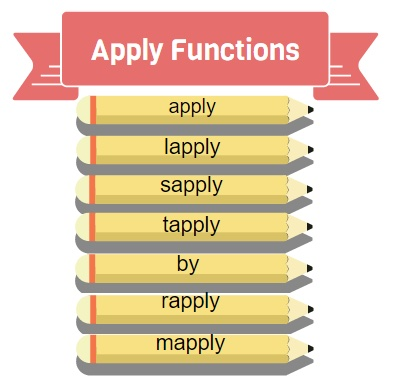



```{r wrap-hook, echo=FALSE}
library(knitr)
library(formatR)
library(webexercises)

# Keep code chunks as written in the .qmd file.
# This avoids early wrapping caused by formatR::tidy_source().
# It is especially useful in teaching materials, where comments are part
# of the explanation.
opts_chunk$set(tidy = FALSE)

# Crop very long outputs when a chunk defines output.lines.
# This keeps the rendered document readable while preserving the full code.
hook_output <- knit_hooks$get("output")
knit_hooks$set(output = function(x, options) {
  lines <- options$output.lines
  if (is.null(lines)) {
    return(hook_output(x, options))
  }

  x <- unlist(strsplit(x, "
"))
  more <- "--- Cropped output ---"

  if (length(lines) == 1) {
    if (length(x) > lines) {
      x <- c(head(x, lines), more)
    }
  } else {
    x <- c(x[lines], more)
  }

  x <- paste(c(x, ""), collapse = "
")
  hook_output(x, options)
})

# In RMD/QMD files, the default wd for R code chunks is usually the directory
# that contains the source document. In a Quarto/RStudio Project, try to avoid
# absolute paths tied to one local computer.
# If needed, uncomment and adapt the following line:
# knitr::opts_knit$set(root.dir = normalizePath(".", winslash = "/", mustWork = TRUE))
```

# [Transform dataframes]{style="color:darkblue"}

Real datasets usually need some preparation before they can be analysed or plotted. We often need to sort rows, select subsets, combine tables, reshape columns, create contingency tables, or calculate summaries by group.

R offers several ways to do these tasks. In this lesson we focus on **Base R**, because it helps you understand the underlying logic of data manipulation. Later, the same ideas will make packages such as `dplyr` and `tidyr` easier to learn.

::: callout-note
## The main idea of R6

R6 is about changing the **shape**, **order** or **level of summary** of a dataset:

- **sort** rows or vectors,
- **subset** selected observations,
- **combine** related tables,
- **reshape** wide tables into long tables,
- **tabulate** frequencies or totals,
- **aggregate** values by group,
- **apply** the same function repeatedly.

Most errors in data analysis happen before the statistical test. This lesson is about making that preparation explicit and reproducible.
:::

## Sorting and subsetting data

Before analysing a dataset, we often need to sort rows or select only the observations that match specific conditions. Sorting can be numerical or alphabetical, increasing or decreasing.

There are two main functions in R to order your data, `sort()` and `order()`. Let's see an example using the file [*coli_genomes_renamed.csv*](data/coli_genomes_renamed.csv), that we used in the lesson [R3](r3.html#save).

```{r}
# Load the dataset used in previous lessons.
coli_genomes <- read.csv(file = "data/coli_genomes_renamed.csv",
                         strip.white = TRUE)

# sort() returns the sorted values.
sort(coli_genomes$Year)
sort(coli_genomes$Year, decreasing = TRUE)

# order() returns the positions that would sort the vector.
# This is useful when we want to reorder rows in a data frame.
order(coli_genomes$Year)

# Both sort() and order() can also be used with character or factor-like data.
sort(coli_genomes$Phylogroup)
order(coli_genomes$Phylogroup)
```

As you noticed, the R function `order()` returns a permutation of the order of the elements of a vector. The output is an index vector, not the vector itself. Also note that if the vector contains any NA values, they will be at the end of the index vector by default.

On the other hand, the function `sort()` returns the vector you pass as input sorted in ascending order by default.

Both functions order the data increasingly, and can be used for numeric or string variables. If you set the `decreasing` argument to `TRUE` in a `sort()` or `order()`, you will get the vector of indices in descending order.

::: callout-tip
## `sort()` versus `order()`

Use `sort()` when you want the **values** in order.

``` r
sort(coli_genomes$Year)
```

Use `order()` when you want the **row positions** that would sort the values. This is the usual function for sorting a complete data frame:

``` r
coli_genomes[order(coli_genomes$Year), ]
```
:::

You can also use these functions to order a data frame according to a vector. Alternatively, you can also arrange or *shuffle* a data frame in reverse order.

```{r}
#order the dataframe by one column, sort or order?
coli_genomes[order(coli_genomes$Year),]
coli_genomes[sort(coli_genomes$Year),] #what happened?

# Random order of rows with sample 
coli_genomes[sample(nrow(coli_genomes), replace = FALSE), ]
# Reverse order of rows
coli_genomes[nrow(coli_genomes):1, ]
```

## [Quick exercise (0): `sort()` or `order()`?]{style="color:darkseagreen"}

You want to sort the **rows** of `coli_genomes` by the column `Year`. Which command is appropriate?

```{r q-sort-order, echo = FALSE, results = 'asis'}
opts <- c(
  "coli_genomes[sort(coli_genomes$Year), ]",
  answer = "coli_genomes[order(coli_genomes$Year), ]",
  "sort(coli_genomes)",
  "order(coli_genomes)"
)
cat("**Select the right answer**", mcq(opts))
```

Now imagine you have a large data set and want to subdivide only some cases (=rows). You already know some ways to do this, but in the following example we will test the function `subset()`, which is very handy when you want to extract the cases that satisfy multiple conditions.

Imagine that for a new project we want to select the strains with better genome design quality or from a subset. We will keep strains from Phylogroup A, with an assembly N50 \> 150,000 bp and less than 100 contigs \>= 1 kb.

```{r}
#option 1: multi-step
selection<-coli_genomes[coli_genomes$contigs1kb<100,]
selection<-selection[selection$N50>150000,]
selection<-selection[selection$Phylogroup=='A',]

#option 2:  which statements 
selection2<-coli_genomes[which(coli_genomes$contigs1kb<100 & coli_genomes$N50>150000 & coli_genomes$Phylogroup=='A'),]

#option 2b:with attach(dataframe) you avoid repeat the name of the dataframe
attach(coli_genomes)
selection2 <- coli_genomes[which(contigs1kb<100 & N50>150000 & Phylogroup=='A'),]
detach(coli_genomes) #detach dataframe

#option 3: subset() is a straightforward way to do that trick 
selection3<-subset(coli_genomes, subset= contigs1kb<100 & N50>150000 & Phylogroup=='A')

```

::: callout-warning
## Avoid `attach()` in analysis scripts

`attach()` can save typing in short examples, but it can also make code harder to debug because variable names may come from different objects. In this lesson, we prefer explicit code such as `coli_genomes$N50` or readable helpers such as `subset()`.
:::

If you want to make sure that the three methods give the same output, you can check the data frame, or check the dimensions or structure with `dim()` or `str()`, but this is difficult with large data sets with hundreds or thousands of cases (see below). The function `all.equal()` does this task for you.

```{r}
#Are they the same?
all.equal(selection,selection2) 
all.equal(selection,selection3)
```

## Combining dataframes

If you work with a lot of data or get different batches of related data frames, you may have multiple tables and want to combine them in different ways. An easy way is to use `cbind()` or `rbind()` if you have the same number of rows and columns. A more practical way is to use the `merge()` function. Look and test the following examples using the *coli_genomes* data frame and a new table named *colis3.csv*

```{r, error=TRUE}
colis <- read.csv2(file = 'data/colis3.csv')
#rbind() and cbind()
rbind(coli_genomes,colis) #did it work? why??
cbind(coli_genomes, colis) 

#merge()
merge<-merge(coli_genomes,colis) #inner join
str(merge)
merge1<-merge(coli_genomes,colis, by="Strain")
str(merge1)
merge2<-merge(coli_genomes,colis, by="Year")
str(merge2)
merge3<-merge(coli_genomes,colis, by=c("Strain","Year"))
str(merge3)
merge4<-merge(coli_genomes,colis, all=TRUE) #outer join
str(merge4)
merge5<-merge(coli_genomes,colis, all.x=TRUE)
str(merge5)
merge6<-merge(coli_genomes,colis, all.y=TRUE)
str(merge6)
merge7<-merge(coli_genomes,colis, by=NULL)
str(merge7)
```

As you noticed, the function `merge()` combines dataframes, however it is a generic function that can be also used with other objects (like vectors or matrices), but they will be coerced to `data.frame` class.

By default, `merge()` will do a *natural join* or *inner join*, merging two dataframes in one that contains only once the common elements of both. The arguments `all = TRUE`, `all.x = TRUE` and `all.y = TRUE` will force an *outer* join in which all elements of both, the first or the second dataframes are selected. In these cases, if not all rows in the first data frame match all the rows in the second, the output is filled with `NA` values in those cases.

Finally, the Cartesian product of both dataframes can be obtained in R by setting the argument `by = NULL` in the `merge()` function.

::: callout-note
## Join types with `merge()`

| Goal                           | Base R code                            |
|--------------------------------|----------------------------------------|
| Keep only matching rows        | `merge(x, y, by = "id")`               |
| Keep all rows from both tables | `merge(x, y, by = "id", all = TRUE)`   |
| Keep all rows from `x`         | `merge(x, y, by = "id", all.x = TRUE)` |
| Keep all rows from `y`         | `merge(x, y, by = "id", all.y = TRUE)` |
| Cartesian product              | `merge(x, y, by = NULL)`               |
:::

### [Quick exercise (I)]{style="color:darkseagreen"}

Two students enrolled in different University courses: Rafa in A, B, D, E and G and Roger in B, C, D and F. Rafa got the following marks 8, 9, 9.5, 8.75 and 9 and Roger obtained 10, 9.7, 9 and 10. Write a R program to create merged dataframes with all the marks (outer join), all the Rafa's marks (left outer), all the Roger's marks (right outer), and the marks in the common courses (inner join).

```{r}
#Create the dataframes
rafa <- data.frame(c("A","B","D","E","G"),c(8,9,9.5,8.75,9.5))
roger <- data.frame(c("B","C","D","F"),c(10,9.7,9,10))
names(rafa) <- c("Course","Rafa")
names(roger) <- c("Course","Roger")
```

```{r wd, echo = FALSE, results = 'asis'}
opts_p <- c("merge(rafa, roger, by = \"Student\")", answer =  "merge(rafa, roger, by = \"Course\")",
   answer = "merge(rafa, roger)",
   "merge(rafa, roger, by = \"Course\", all=TRUE)")

cat("**How would you obtain a table containing the marks of both students only for their common courses?**",longmcq(opts_p))
```

```{r wd2, echo = FALSE, results = 'asis'}
opts_p <- c("merge(rafa, roger, by = \"Student\")",  "merge(rafa, roger, all.y=TRUE)",
   answer = "merge(rafa, roger, all.x=TRUE)",
   "merge(rafa, roger, by = \"Course\", all=TRUE)")

cat("**How would you obtain a table containing the marks of both students only for Rafa's courses?**",longmcq(opts_p))
```

## Data matrix format (wide vs. long table) {#zebra}

::: {.callout-important icon="false"}
##  How should I arrange my data table?

A column per experimental condition or a column per variable? Is the same?
:::

In the table [*Zebrafish_data.csv*](data/Zebrafish_data.csv) from the Lesson R5 we have the results of an experiment in which a collaborator scored the number of metastatic cancer cells upon the expression of different transcripts of the EFNA3 gene. Each transcript is cloned into a pLoC plasmid, and we have negative (empty plasmid) and positive controls (wt transcript). Let's import and check the data.

```{r}
# Read the zebrafish table from R5.
ZFdata <- read.csv("data/Zebrafish_data.csv")

# In the current table, each experimental condition is a different column.
str(ZFdata)
head(ZFdata)
```

How many columns has the table? How many variables are there?

Here we have one column per experimental condition. Thus, this table format does not agree with the standard way to introduce the data in a table, the data-matrix: Rows for cases and columns for variables.

Having the data in a long format is especially useful for grouped plots, aggregated summaries and many modelling functions. We transform the table into a data matrix, or **long table**, using the function `stack()`. You can also do it the other way around with the function `unstack().`

```{r}
# stack() converts several columns into two columns:
# - values: the measurements
# - ind: the original column name, used as group label
ZF_stacked <- stack(ZFdata)
str(ZF_stacked)
head(ZF_stacked)

# unstack() can reverse the transformation in simple cases.
ZF_old <- unstack(ZF_stacked)
str(ZF_old)
head(ZF_old)
```

However, sometimes the dataset is more complex and there are other variables that change the table structure, as in the table [*Zebrafish_full.csv*](data/Zebrafish_full.csv)*.* In this case, remember that stack is designed to transform tables of only two variables. Thus, you must stack only the desired two variables and then construct the table by adding the rest of the information, for instance with `cbind()`, as in the example below.

```{r}
ZF_full <- read.csv("data/Zebrafish_full.csv", row.names=1)
head(ZF_full)
#option 1:
#step1: stack two main variables (sample & number of cells)
ZF_full_some_stack <- stack(ZF_full[,1:6])
head(ZF_full_some_stack,15)
#step2: reconstruct the table adding the third variable
ZF_full_stack <- cbind(ZF_full_some_stack,ZF_full[,7])
colnames(ZF_full_stack) <- c("Cells","Sample","Assay")
head(ZF_full_stack,15)
#option2: shortcut
ZF_full_stack2 <- cbind(stack(ZF_full[,1:6]),ZF_full[,7])
colnames(ZF_full_stack2) <- c("Cells","Sample","Assay")
head(ZF_full_stack2,15)
#the same result in both cases?
all.equal(ZF_full_stack,ZF_full_stack2)
```

Remember that ***datamatrix*** is not an R structure, but a general concept in data analysis. Also, for more complex dataframes, I suggest to use the function `melt()`. However, this function name refers to two different functions in two alternative packages: *reshape2* and *data.table*, with slightly different behavior.

### [Quick exercise (II)]{style="color:darkseagreen"}

From the previous exercise with marks of two students, we have a table `students` with all the marks, in which each student is a column.

```{r}
students <-  merge(rafa, roger, by = "Course", all = TRUE)
students
```

However, we need a table in which each column is a variable, as follows:

```{r echo=FALSE, eval=TRUE}
students2 <- cbind(students[,1], stack(students[,2:3]))
names(students2) <- c("Course","Mark","Student")
students2
```

How would you obtain the second table?

```{r, echo = TRUE, error = TRUE, eval = TRUE, webex.hide = "See an answer"}
#1. Create the table
students2 <- cbind(students[,1], stack(students[,2:3]))
#Note that we have used stack() for only two columns and bind the output with the column 1 in the previous table

#2. Rename variables
names(students2) <- c("Course","Mark","Student")

#3. Show table
students2
```

# [Working efficiently with large datasets]{style="color:darkblue"}

## Fast loading of huge datasets and creation of contingency tables

We are going to make some examples with a huge dataset of Covid19 Vaccination data in EU. The data is publicly available at <https://opendata.ecdc.europa.eu/covid19/vaccine_tracker/csv/data.csv>. That is a big file that cannot be hosted on GitHub, so we can download it and save in our data folder. For instance, I used the name `vaccines_EU_22oct2022.csv`.

::: callout-note
From this point on, in some examples we will show only some lines of the output of the code chunks (you will notice that the output ends with ***--- Cropped output ---***). Otherwise, this document is very long and difficult to follow.

As always, it's encouraged to run the code yourself to see and understand the full returned output.
:::

```{r error=TRUE, output.lines=(1:20), eval=FALSE}
# Open directly from the ECDC website.
# This is not evaluated when rendering the lesson to avoid depending on an internet connection.
vaccines <- read.csv(file = "https://opendata.ecdc.europa.eu/covid19/vaccine_tracker/csv/data.csv", header = TRUE)

#explore the data
str(vaccines)
head(vaccines)

```

Even with large datasets, we can use `table()` or `summary()` functions, to overview data. But, sometimes we just doesn't.

```{r eval=TRUE,echo=FALSE}
vaccines <- data.table::fread(file = "https://opendata.ecdc.europa.eu/covid19/vaccine_tracker/csv/data.csv", header = TRUE)
```


```{r error=TRUE}
table(vaccines$Region)
```

```{r output.lines=(1:30)}
table(vaccines$Region, vaccines$NumberDosesReceived)
```

```{r error=TRUE}
summary(vaccines[which(vaccines$Region=="ES"),][,6]) #see the data from Spain
table(vaccines)
```

When exploring (very) large datasets as in the example above you can find that some functions don't work because they can't handle all that data (*Error in table(vaccines) : attempt to make a table with \>= 2\^31 elements*). Here, we are going to use alternative methods, more efficient and convenient for reading and handle these large datasets.

One of those tricks is the use of the package *data.table*, very handy for large datasets. In the following lines, we will compare reading/writting data with the function `fread()` and `fwrite().`

```{r}
#load the package may require installing it before
if(!require(data.table)){
    install.packages("data.table")
}
# if that doesn't work try: install.packages("data.table", type = "source", repos = "https://Rdatatable.gitlab.io/data.table")

system.time(vaccines <- read.csv(file = 'data/vaccines_EU_22oct2022.csv', header=TRUE))
system.time(vaccines<-fread('data/vaccines_EU_22oct2022.csv'))

#we can also prevent loading of some columns  to save time
system.time(vaccines2 <-fread('data/vaccines_EU_22oct2022.csv',drop=c(3,5,7,9,10)))  
system.time(vaccines3 <-fread('data/vaccines_EU_22oct2022.csv',colClasses = "character")) #we can also select the variables by type
```

## Frequency tables: `table()` vs. `xtabs()`

Tabulating frequencies is a common and efficient way to explore data. While the `table()` function is versatile and can be used with various data structures (vectors, dataframes, lists...), it might become less convenient for complex cross-tabulations, especially with large datasets. Alternatively, as shown below, the `xtabs()` function offers a more streamlined approach, particularly for multi-dimensional tables. It leverages a formula-based syntax, allowing for easy specification of variables and automatic generation of row and column labels. Additionally, the data= argument in `xtabs()` simplifies the process by directly referencing variable names within the dataframe.

```{r }
#compare table() and xtabs()
table(vaccines$ReportingCountry)
str(table(vaccines$ReportingCountry))
xtabs(formula= ~ ReportingCountry  ,data=vaccines)
str(xtabs(formula= ~ ReportingCountry  ,data=vaccines))
#Note: library(stats) if xtabs() does not work
```

So far, they seem very similar in terms of coding and obtained output. However, what about if you want to use to several variables?

```{r output.lines=(1:25)}
#with 2 or more variables?
# This would not work as written because ReportingCountry and Vaccine are column names.
# table(vaccines[, c("ReportingCountry", "Vaccine")])
table(vaccines$ReportingCountry,vaccines$Vaccine) #yes!

## you can also use "with", but not so intuitive to me
with(vaccines, table(ReportingCountry, as.factor(Vaccine))) 


#more straightforward alternative with xtabs
(vaccines_split <- xtabs(formula= ~ ReportingCountry  + as.factor(Vaccine), data = vaccines))

```

As mentioned above, `xtabs()` can be easily used with more than two variables. Moreover, you can create a cross-tabulated table using a numeric variable instead of frequencies. To do so, you just need to use the left side of the formula.

```{r output.lines=(1:50)}
#also with several variables
(vaccines_split2 <- xtabs(NumberDosesReceived ~ ReportingCountry  + as.factor(Vaccine) + as.factor(TargetGroup), vaccines))
```

That was a very long output to check! If you want to show your tabulated data in a more useful format, you can convert the cross-tabulated data into a flat table with `ftable()`. See the examples below and try to understand how the `row.bars` statement works.

```{r output.lines=(1:25)}
ftable(vaccines_split, row.vars = 2)
ftable(vaccines_split2, row.vars = 2)
ftable(vaccines_split2, row.vars = 3)
```

### [Quick exercise (III)]{style="color:darkseagreen"}

Sometimes, it is better to use a shorter table as an example... Let's go back to the *coli_genomes* data that you already know.

```{r wd_genomes, echo = FALSE, results = 'asis'}
opts_p <- c("with(coli_genomes, table(Source, Phylogroup))",
   answer = "xtabs(Contigs ~ Source + Phylogroup, coli_genomes)",
   "xtabs( ~ Contigs + Source + Phylogroup, coli_genomes)")

cat("**Could you obtain a table like the following, with the number of Contigs by isolation source (*Source*) and phylogenetic group (*Phylogroup*)?**",longmcq(opts_p))
```

```{r echo=F, eval=T}
xtabs(Contigs ~ Source + Phylogroup, coli_genomes)
```

Now, let's do it a little bit more complicated. If we split the previous table by the STs (aka. multilocus sequence typing), you obtain a very large table:

```{r echo=F, eval=T, output.lines=(1:50)}
(coli_xgenomes <- xtabs(Contigs ~ Source + Phylogroup + Sequence.Type, coli_genomes))
```

This is quite a long cross-table that we have cropped on the output, maybe you could find more convenient transforming it to a flat contingency table with `ftable()`.

```{r wd_xgenomes, echo = FALSE,  results = 'asis'}
opts_p <- c("ftable(coli_xgenomes)",
   "ftable(coli_xgenomes, col.vars=1",
  answer = "ftable(coli_xgenomes, row.vars=3",
  answer = "ftable(coli_xgenomes, col.vars=c(1,2)"
  )

cat("**How would you generate a flat table using the previous cross-tabulated table?**",longmcq(opts_p))
```

If you test the different options, you will notice that the format of the table can be defined by the order of the variables and also using the arguments `row.vars` and `col.vars` to define which variables will be summarized as column or row.

Again, rather than concepts from R or RStudio, cross-tabulation and flat contingency tables are general concepts in data analysis.

# [Data aggregation and transformation]{style="color:darkblue"}

## By() & aggregate()

While frequency tables can be very quickly generated with `table()` and `xtabs()`, sometimes you may want other calculations than frequency, like basic statistics per group or other, even custom, calculations.

You have already tried the function `by()` as a very useful trick to make group-calculations. However, this function has some limitations when we have large datasets and when we try to use multiple factors that can be solved with `aggregate()`. In both cases, the function can be any function that suits your data, either from R packages or a custom function.

In the following example, we are using a smaller dataset named *vaccines2* that we can obtain by *sampling* (random extraction of a portion of data) with the R function `sample()`.

```{r error=TRUE, output.lines=(1:25)}
vaccines2 <- vaccines[sample(x = 1:nrow(vaccines),size = 50000, replace=FALSE),]

#using by()
by(vaccines2$NumberDosesReceived, INDICES = vaccines2$Region, FUN=mean, na.rm=TRUE)
```

In the example above, we could calculate the mean by groups. Can we do it with more than one grouping factor? Let's try some alternatives and see the output

```{r error=TRUE, output.lines=(1:25)}
by(vaccines2$NumberDosesReceived, INDICES = vaccines2$Region + vaccines2$Vaccine, FUN=mean, na.rm=TRUE)
by(vaccines2$NumberDosesReceived, INDICES = c(vaccines2$Region,vaccines2$Vaccine), FUN=mean, na.rm=TRUE)
by(vaccines2$NumberDosesReceived, INDICES = list(vaccines2$Region,vaccines2$Vaccine), FUN=mean, na.rm=TRUE)
```

When `by()` becomes difficult to read, `aggregate()` is usually the best quick alternative

```{r,  output.lines=(1:15)}
#aggregate is more convenient sometimes
aggregate(vaccines2$NumberDosesReceived ~ vaccines2$Region, FUN=mean)
aggregate(NumberDosesReceived ~ Region+Vaccine, data=vaccines2, FUN=mean) 
aggregate(FirstDoseRefused ~ TargetGroup, data=vaccines2, FUN=median) 
#note that by default NAs are disregarded
aggregate(FirstDoseRefused ~ TargetGroup, data=vaccines2, na.action = NULL, FUN=median) 

#we can make it for several numeric variables at the same time
aggregate(cbind(NumberDosesReceived,FirstDose,SecondDose) ~ as.factor(TargetGroup), data=vaccines2, FUN=mean)
```

We can also add a custom function, using the short, usually with the inline notation:

```{r }
#we can also use custom functions here
aggregate(cbind(FirstDose,SecondDose) ~ as.factor(TargetGroup), data=vaccines2, FUN=function(x) mean(x)*100/mean(vaccines2$NumberDosesReceived, na.rm=TRUE))
```

### [Quick exercise (IV)]{style="color:darkseagreen"}

We are using again the *coli_genomes* dataframe.

```{r wd_genomes_agg, echo = FALSE, results = 'asis'}
opts_p <- c("aggregate(cbind(VF,Plasmids) ~ Source, data=coli_genomes, FUN=mean)",
            "aggregate(cbind(VF,Plasmids) ~ Source, data=coli_genomes, FUN=function(x) mean(x) * 100 / mean(Assembly_length))",
   answer = "aggregate(cbind(VF,Plasmids) ~ Source, data=coli_genomes, FUN=function(x) mean(x)  * 100 / mean(coli_genomes$Assembly_length))" )

cat("**Can you obtain the  following table displaying the mean (%) of virulece factors (VF) and plasmids per genome nucleotide (Assembly_length) grouped by Source**",longmcq(opts_p))
```

```{r echo=F, eval=T}
aggregate(cbind(VF,Plasmids) ~ Source, data=coli_genomes, FUN=function(x) mean(x)*100/mean(coli_genomes$Assembly_length))
```

## Apply family of functions

::: {style="float: left; position: relative; top: 0px; padding: 3px;"}
[{width="428"}](https://www.r-bloggers.com/2016/03/apply-lapply-rapply-sapply-functions-in-r-2/)
:::

The **apply** family of functions applies the same function repeatedly to elements of a data structure. It includes various functions, designed for matrices, dataframes or lists. What is special about these functions is that their arguments are not only data but also functions. Using an **apply** function can seem complicated at first, but it is very useful for avoiding repetitive code. In this section, we look at the `apply()` function and its variants, including `lapply()`, `sapply()`, `tapply()`, `rapply()` & `mapply()`. In general, **Apply** is a very efficient tool to perform repetitive calculations.

Rather than describing in detail all the functions, in the following examples we test some of the possibilities of some *applies*. Try yourself and check the code comments.

::: callout-note
## Which apply function should I try first?

- `apply()` is useful for rows or columns of a matrix-like object.
- `lapply()` applies a function and returns a list.
- `sapply()` is similar to `lapply()`, but tries to simplify the result.
- `tapply()` applies a function to a vector split by groups.
- `vapply()` is like `sapply()`, but requires the expected output type.
- `mapply()` is useful when the function needs several input vectors.
- `rapply()` is useful for recursive operations on nested lists.
:::

```{r, output.lines=(1:6)}
#apply()
apply(vaccines[,4:12], MARGIN = 1, FUN = mean, na.rm=TRUE)
apply(vaccines[,4:12], 2, mean, na.rm=TRUE) # 1 for row-wise operation, 2 for column-wise
```

```{r}
apply(vaccines, 2, is.numeric)
apply(vaccines[,3:6], 2, is.numeric)
```

Note that you can use any function, although `apply()`is best suited for numeric calculations as it coerces your data to an array (via `as.matrix()`). Thus, when a dataframe cannot be transformed in a matrix your function may return fail. In the example above `is.numeric()` returns false for all columns within the apply when the dataframe contains character data, but if we use a subset that only contains numeric data the result makes sense. As you can see below, `sapply()` and `lapply()` are best suited for this kind of functions.

```{r error=TRUE,output.lines=(1:25)}
#lapply() and sapply() are very useful
lapply(by(vaccines$Population,vaccines$ReportingCountry,mean), log10) 
```

```{r error=TRUE}

sapply(by(vaccines$Population,vaccines$ReportingCountry,mean), log10) 
class(lapply(by(vaccines$Population,vaccines$ReportingCountry,mean), log10) ) 
#lapply take a list (or object that can be coerced as one) and gives a list
class(sapply(by(vaccines$Population,vaccines$ReportingCountry,mean), log10) ) 
#sapply is actually a 'wrapper' of lapply that returns a vector or matrix instead of a list


sapply(list(vaccines2$Population, vaccines2$FirstDose,vaccines2$SecondDose, vaccines2$NumberDosesReceived), median) # we can do it with several variables
sapply(vaccines2,class) #again, you can use any function, not only numeric calculations
sapply(vaccines2, is.numeric) 
```

```{r error=TRUE,output.lines=(1:10)}
#other apply functions are more case-specific:

#mapply() is the matrix (or multivariable) version
mapply(sub,vaccines2[,4],vaccines2[,6],vaccines2[,7]) 
```

```{r error=TRUE}

mapply(rep, letters[1:4], 4:1)

#tapply() breaks a vector into pieces, can be used instead of aggregate
tapply(vaccines$NumberDosesReceived, vaccines$ReportingCountry, median,na.rm=TRUE) 
tapply(coli_genomes$VF, coli_genomes$Source, mean, na.rm=TRUE) 
```

```{r error=TRUE}
#vapply() is similar to sapply(), but has a pre-specified type of return value
vapply(vaccines[,8:11],mean,numeric(1))
```

```{r error=TRUE,output.lines=(1:10)}

vapply(vaccines[,8:11],function(x) x^2,numeric(nrow(vaccines)))

```

```{r error=TRUE}

#rapply can be a handy trick for recursive calculations
rapply(vaccines, mean, class="integer") 
rapply(vaccines, table, class="factor")
```

```{r error=TRUE,output.lines=(1:10)}


vaccines$ReportingCountry<-as.factor(vaccines$ReportingCountry)
vaccines$Vaccine<-as.factor(vaccines$Vaccine)
vaccines$TargetGroup<-as.factor(vaccines$TargetGroup)
vaccines$Region<-as.factor(vaccines$Region)
rapply(vaccines, table, class="factor") #factors need to be defined and now it gives the counts for each group of each factor

rapply(vaccines, median, how="list", class="integer", na.rm=TRUE) #returns a list

```

```{r error=TRUE}

rapply(vaccines, median,  how="unlist",class="integer", na.rm=TRUE) #gives a vector


#what do you mean by RECURSIVELY?
x <- list("a",list(24,443),434,list(54,list(6443,7234))) #this is a complex list with sublists

str(x)

rapply(x,log2,class=c("numeric"))
(r <- rapply(x,log2,class=c("numeric"), how="unlist"))
str(r)
```

Note that `tapply()` and `by()` are very similar. Indeed, `by()` is a wrapper of `tapply()`. On the other hand, `vapply()` is similar to `sapply`, but has a pre-specified type of return value, so it can be safer (or faster) to use sometimes. Finally, `rapply()` is not very often used, but it can be the best option for complex datasets, like those including nested lists or complex lists with several dataframes and/or vectors.

The applications of *apply* functions are very wide, particularly the `apply()` and `lapply()`. You can use them to parse data with many different input and output structures and almost any kind of R functions, including plots (see Lesson R8).

### [Quick exercise (V)]{style="color:darkseagreen"}

Of course, based on the *coli_genomes* dataframe.

```{r wd_apply, echo = FALSE, results = 'asis'}
opts_p <- c("apply(coli_genomes,2,log10(mean), na.rm=TRUE)",
            "apply(coli_genomes,1,log10(mean), na.rm=TRUE)",
            "lapply(coli_genomes,log10(mean), na.rm=TRUE)",
            "sapply(coli_genomes,log10(mean), na.rm=TRUE)",
   answer = "None of the previous" )

cat("**How would you obtain the logarithm of the mean of all the columns?**",longmcq(opts_p))
```

Yes, a function must be suitable for the selected data and the dataframe *coli_genomes* contains numeric and categorical variables, but the function *log10(mean)* only can work with numeric data. Let's do it in two steps:

```{r wd_apply2, echo = FALSE, results = 'asis'}
opts_p <- c("apply(coli_genomes, 2, is.numeric) ",
            "coli_genomes[lapply(coli_genomes, is.numeric)]",
   answer = "coli_genomes[sapply(coli_genomes, is.numeric)]",
    "sapply(coli_genomes, is.numeric)",
            "lapply(coli_genomes, is.numeric)")

cat("**How would you select only numeric columns?**",longmcq(opts_p))
```

```{r wd_apply3, echo = FALSE, results = 'asis'}
opts_p <- c("apply(coli_genomes[sapply(coli_genomes, is.numeric)],2,function(x)log(mean(x))) ",
            "apply(coli_genomes[sapply(coli_genomes, is.numeric)],2,log(mean)) ",
            "apply(coli_genomes[sapply(coli_genomes, is.numeric)],2,fun(x) log(mean), na.rm=TRUE)",
            answer= "apply(coli_genomes[sapply(coli_genomes, is.numeric)],2,function(x)log(mean(x, na.rm=TRUE)))" )

cat("**How would you obtain the logarithm of the mean of all the numeric columns?**",longmcq(opts_p))
```

::: callout-tip
## General workflow for data management

A useful workflow for R6 tasks is:

1.  Inspect the table with `str()`, `head()` and `dim()`.
2.  Decide whether you need to sort, subset, merge, reshape, tabulate or aggregate.
3.  Perform one transformation at a time.
4.  Store intermediate objects with clear names.
5.  Check results with `dim()`, `str()` and `all.equal()` when appropriate.
6.  Only then move to plotting or statistical testing.
:::

# References {#sec-references}

1.  Manipulación de datos en R: <https://r-coder.com/manipulacion-datos-r/> \[ES\] & <https://r-coder.com/r-data-manipulation/> \[EN\]

2.  *R in action.* Robert I. Kabacoff. March 2022 ISBN 9781617296055

3.  Working with tables in R: <https://bookdown.org/kdonovan125/ibis_data_analysis_r4/working-with-tables-in-r.html>

4.  About flat tables in R: <https://cran.r-project.org/web/packages/memisc/vignettes/ftable-matrix.html>

5.  *data.table* cheatsheet: <https://raw.githubusercontent.com/rstudio/cheatsheets/main/datatable.pdf>

6.  Data aggregation: <https://r-coder.com/aggregate-r/>

7.  About *Applies*: <https://www.r-bloggers.com/2016/03/apply-lapply-rapply-sapply-functions-in-r-2/> & <https://gist.github.com/lyndametref/4d137fcba1ec4d9af80ad53245b358ff>

8.  Efficient data management in R: <https://www.mzes.uni-mannheim.de/socialsciencedatalab/article/efficient-data-r/>

# [Review Exercises]{style="color:darkgreen"}[^1]

[^1]: Check proposed answers in the repo: <https://github.com/r4biochemists/r4biochemists.github.io/tree/main/answers2exercises>

We are using the COVID-19 testing data for these exercises. You can download the updated *csv* file from <https://opendata.ecdc.europa.eu/covid19/testing/csv/data.csv> (see also <https://www.ecdc.europa.eu/en/publications-data/covid-19-testing>). Read and explore the data. I also suggest to save the table in your computer as *covid_tests.csv*.

#### 1. Generate two contingency tables showing the number of tests done (1) by country per week and (2) by country per month.

Hint. For the second table, use the function *ISOweek2date()* from the package "ISOweek" to transform the ISO date_week to standard date format.

#### 2. Remove all the character columns to create a subset dataframe named *minitests*. You can use `subset()` and `sapply()` here.

#### 3. Use apply() to obtain the min, max, median and mean of each column.

#### 4. Use `tapply()` to obtain the mean, median and min of new_cases per country and construct a dataframe with the result.

Hint. Consider how to handle NA's.

# [Extra exercises]{style="color:green"}

The topics in this lesson can be dense and bewildering the first time. I selected some sheets of exercises from great websites that can give you an extra practice.

- <https://www.r-exercises.com/2016/04/14/merging-dataframes-exercises/>

- <https://www.r-bloggers.com/2016/05/cross-tabulation-with-xtabs-exercises/>

- <https://www.r-exercises.com/2016/09/08/efficient-processing-with-apply-exercises/>

- <https://www.r-exercises.com/2016/06/16/summary-statistics-with-aggregate/>

# Session Info

```{r}
sessionInfo()
```
