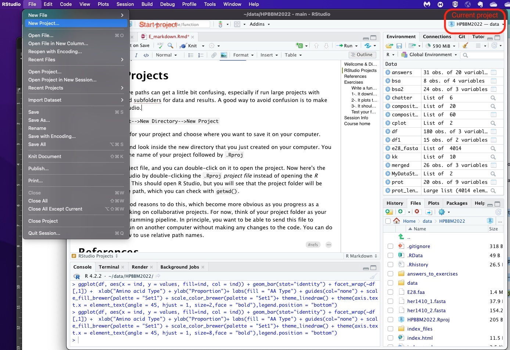
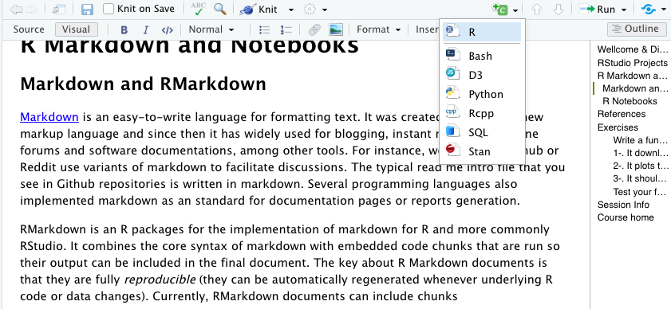
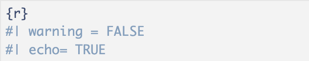
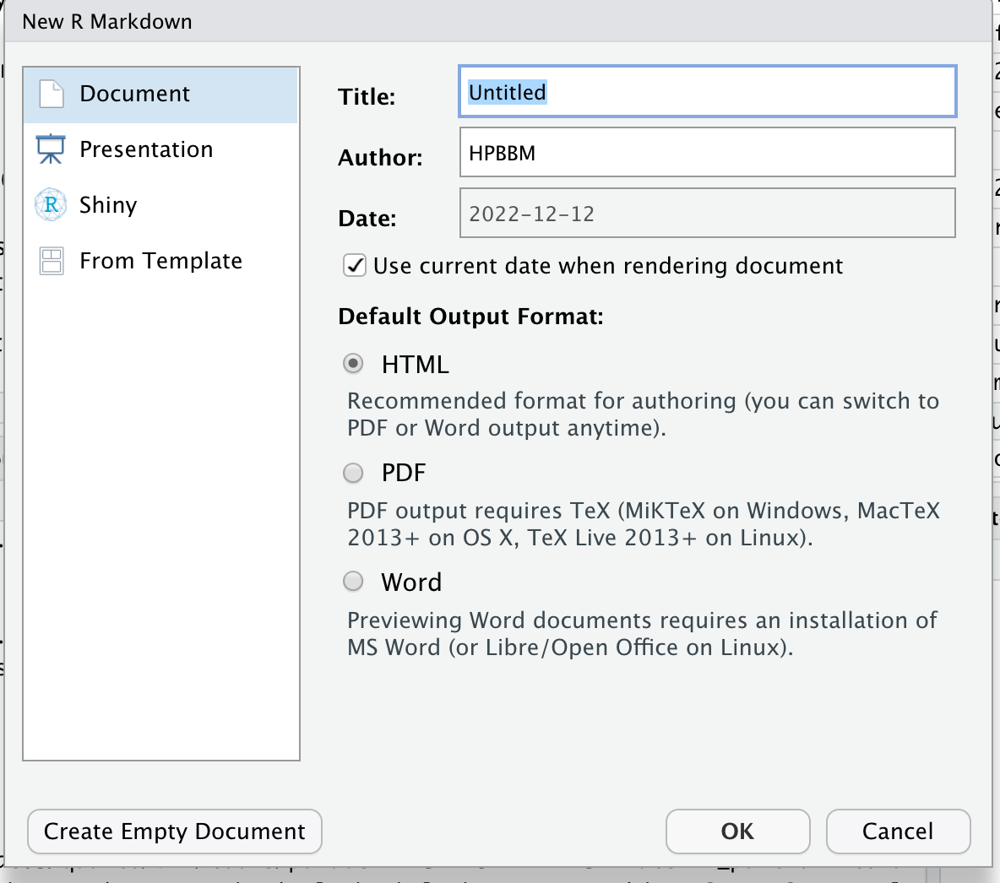
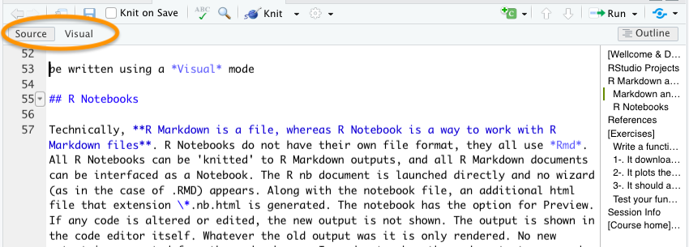



```{r wrap-hook, echo=FALSE}
library(knitr)
library(formatR)

# Keep code chunks as written in the .qmd file.
# This avoids early wrapping caused by formatR::tidy_source().
opts_chunk$set(tidy = FALSE)

# Crop very long outputs when a chunk defines output.lines.
hook_output <- knit_hooks$get("output")
knit_hooks$set(output = function(x, options) {
  lines <- options$output.lines
  if (is.null(lines)) {
    return(hook_output(x, options))
  }

  x <- unlist(strsplit(x, "
"))
  more <- "--- Cropped output ---"

  if (length(lines) == 1) {
    if (length(x) > lines) {
      x <- c(head(x, lines), more)
    }
  } else {
    x <- c(x[lines], more)
  }

  x <- paste(c(x, ""), collapse = "
")
  hook_output(x, options)
})
```

# [Reproducibility in computational analysis]{style="color:darkblue"}

As you know, the rapid expansion of research data and the growing emphasis on data-driven science have pushed the research community to develop solutions for managing and automating complex computational processes. These efforts aim to ensure efficiency, reproducibility, scalability, collaboration, and transparent, quality-assured practices. In this context, recent developments in computational and data sciences highlight the increasing recognition and adoption of computational workflows as essential tools for productivity and reproducibility. Workflows not only streamline processes but also democratize access to platforms and technical expertise. When treated as digital objects that can be shared, discovered, and reused, computational workflows align closely with the **FAIR** principles—Findable, Accessible, Interoperable, and Reusable (see [Ref. 15](#refs)).

This lesson introduces practical tools to help you apply FAIR principles in your bioinformatics workflows and data analysis using R.

## A project is more than a script

In small exercises, it may be enough to run a few lines of code in the console. In a real project, this is not enough. A project usually contains a question, one or more data files, several scripts or chunks, intermediate objects, final figures, and a written interpretation.

A reproducible project should answer four practical questions:

1.  **Where are the data?**
2.  **Which code generated the results?**
3.  **Which output files are final and which are temporary?**
4.  **Can another person re-run the analysis without guessing missing steps?**

::: callout-tip
## Project habit

Do not start a project by creating a file called `analysis_final_v3_REAL.R`. Start by creating a project folder with a clear structure, a short README, and one main document that explains the analysis.
:::

# [RStudio Projects]{style="color:darkblue" #rprojects}

Working with relative paths can get a little bit confusing, eespecially if run large projects with different folders and subfolders for data and results. A good way to avoid confusion is to make an R project in RStudio.



As you can see in the screenshot above you can easily start a new project in RStudio using the *File* menu. Then, just select a name and save it on your computer (it will have the extension *Rproj*).

Now here's the cool part: When you open your project, you will see that the project folder will be your default relative path, which you can check with `getwd()`. Also, in the top-right corner of RStudio you can see the project name and the containing folder.

Working with projects come along with other extra features. For instance, every time you open the project, the *.Rdata* and the *.Rhistory* are loaded; thus previously edited source documents and RStudio settings (e.g. active tabs, splitter positions, etc.) are restored. This will make a difference if you manage different projects at the same time.

## Recommended folder structure for course projects

For the projects in this course, I recommend using a simple and predictable folder structure. You may adapt it to your topic, but try to keep the logic clear.

``` text
my_project/
├── my_project.Rproj
├── README.md
├── analysis.qmd
├── data/
│   ├── raw/
│   └── processed/
├── scripts/
├── results/
│   ├── tables/
│   └── figures/
└── references/
```

A possible rule is:

- `data/raw/`: original data files. Do not edit these manually.
- `data/processed/`: cleaned or transformed data generated by your code.
- `scripts/`: helper scripts or functions.
- `results/tables/`: final or intermediate tables generated by the analysis.
- `results/figures/`: final plots for the report.
- `references/`: papers, notes, metadata or documentation.

::: callout-warning
## Do not use absolute paths in your project

Avoid paths such as:

``` r
read.csv("C:/Users/Ana/Desktop/project/data/table.csv")
```

Prefer project-relative paths:

``` r
read.csv("data/raw/table.csv")
```

This makes the project easier to move, share and review.
:::

### [Quick exercise: inspect your project]{style="color:darkseagreen"}

After creating a project, run:

```{r project-inspection, eval=FALSE}
getwd()
list.files()
list.files("data", recursive = TRUE)
```

Discuss with your group:

- What is the project root?
- Where should raw data be stored?
- Where should final figures be saved?
- Which files would you need to share for another person to reproduce the analysis?

There are more reasons to do this, which become more obvious as you progress as a coder and start working on collaborative projects. You can also create your project using a version control (Git or Subversion) repository. Version control helps software teams manage changes to source code over time. Version control software keeps track of every modification to the code in a special kind of database. If a mistake is made, developers can turn back the clock and compare earlier versions of the code to help fix the mistake while minimizing disruption to all team members. Version control systems have been around for a long time but continue to increase in popularity with data science workflows.

## Version control and collaboration

Version control is useful even when you work alone. It helps you record the history of a project and recover previous versions when something breaks. In a group project, it also helps coordinate changes between team members.

You do not need to become a Git expert for this course, but you should understand the basic logic:

``` text
change files → review changes → commit → continue working
```

A good commit message should briefly explain what changed. For example:

``` text
Add first version of growth curve plot
Fix metadata import for genome table
Update discussion after group feedback
```

::: callout-note
## For your course projects

If you use GitHub or another repository, do not upload sensitive, private or very large files unless you are sure that this is appropriate. In many cases, raw data can be described in the README and stored separately, while the code and small example files are kept in the repository.
:::

# [R Markdown and Notebooks]{style="color:darkblue"}

## Markdown and RMarkdown

[Markdown](https://en.wikipedia.org/wiki/Markdown) is an easy-to-write language for formatting text. It was created in 2004 as a new markup language and since then it has widely used for blogging, instant messaging, online forums and software documentation, among other tools. For instance, websites like Github or Reddit use variants of markdown to facilitate discussions. The typical read me intro file that you see in Github repositories is written in markdown. Several programming languages also implemented markdown as a standard for documentation pages or reports generation.

`RMarkdown` is an R package for the implementation of markdown for R and more commonly RStudio. It combines the core simple syntax of markdown with embedded code chunks that are run so their output can be included in the final document. The key about R Markdown documents is that they are fully *reproducible* (they can be automatically regenerated whenever underlying R code or data changes).

Currently, RMarkdown documents can include chunks in different languages (see the screenshot below), so you can combine in the same document *bash* or *Python* scripts along with the R data analysis. Moreover, despite simplicity of its syntax it can include diverse formatting options, spanning enriched text to HTML or Latex contents as well.



Also, they can be written using a *Visual* mode (above) that looks like any other word processor, but you can switch to *Source* anytime.


I found two main advantages in using RMarkdown documents for my data analysis. Initially, I started to use it in order to generate formatted reports including all the information about the project in a paper-like format, from the background to the data analysis and the conclusions. Indeed, those "reports" can be as fancy as you wish, from html or latex-formatted pdf, to MS Word or even presentations. A second benefit of the use of markdown is that it facilitates your own work a lot, especially when you work in several different projects or if you need to do some analysis after some time. Additionally, you can use Rmarkdown documents for web applications based on R using [Shiny](https://shiny.rstudio.com/).

Moreover, there are a number of specialized sites to publish your Rmarkdown documents, such as [Rpubs](https://rpubs.com/), [bookdown.org](https://bookdown.org/home/about/) or [RStudio connect](https://rstudio.com/products/connect/).

You can insert a chunk by writing the header ```` ```{r} ```` and foot ```` ``` ```` if you work in the `Source` mode or with green **+C** button in the `Visual` mode. See the example below.

```{r, label='my-first-chunk', eval=FALSE}
{r, label='my-first-chunk'}

```

Code in the chunks can be executed line-by-line using Ctrl+ENTER (Cmd+Enter in MacOS) or as a whole chunk using the play button on the top-right corner. Also, chunk output can be customized with some options (see [Ref. 11](#r9)) that allow you to choose whether a particular chunk will be executed or not or include invisible chunks that will not be shown in the final knitted doc... Some examples are (note that boolean properties are True by default):

- `include = FALSE` prevents code and results from appearing in the finished file. R Markdown still runs the code in the chunk, and the results can be used by other chunks.

- `echo = FALSE` prevents code, but not the results from appearing in the finished file. This is a useful way to embed figures.

- `message = FALSE` prevents messages that are generated by code from appearing in the finished file.

- `warning = FALSE` prevents warnings that are generated by code from appearing in the finished.

- `fig.cap = "..."` adds a caption to graphical results.

- `label = " "` sets a name or label specific to that chunk

For project reports, chunk labels are useful because they make errors easier to locate and figures easier to reference. Prefer informative labels such as `load-data`, `clean-data`, `plot-growth-curves` or `summary-table`.

::: callout-note
## Chunk options and project reports

Do not hide code automatically. In a teaching project, visible code is often useful because it shows how the result was obtained. Use `echo = FALSE` only when the code is not relevant for the reader or when you are preparing a polished final version.
:::

Chunk options arguments can be set in the `{}` of a chunk header. Alternatively, you can write chunk options in the body of a code chunk after `#|`, e.g.,

{width="336"}

Further customization options in R Markdown can be found in the references listed below. I eespecially recommend references 5 and 6 to start customizing your HTML Markdown documents, including different section headers, a table of contents (TOC), or even a personalized color scheme.

### Using R Markdown for the course project

For the course project, an R Markdown or Quarto document can work as a **lab notebook**, **analysis script** and **final report** at the same time. A good report should not only show code. It should explain why each step is done and what the output means.

A useful structure is:

``` text
1. Question or objective
2. Data source and variables
3. Data import and cleaning
4. Exploratory analysis
5. Main analysis or comparison
6. Figures and tables
7. Interpretation
8. Limitations and next steps
9. Session information
```

::: callout-tip
## Write for your future self

Imagine that you reopen the project in three months. Would you understand where the data came from, why a filtering step was applied, and how the final figure was produced? If not, add a short explanation in the document.
:::

::: callout-note
## Minimal project report template

You can start a project report with a structure like this:

```markdown
---
title: "Project title"
author: "Student names"
format: html
---

# Objective

What biological or analytical question are we trying to answer?

# Data

Where do the data come from? What does each row represent?
```
```{r eval=FALSE}
data <- read.csv("data/raw/my_data.csv")
str(data)
head(data)
```
```markdown
# Analysis

Explain each step before showing the code.
```
```{r eval=FALSE}
# analysis code here
```
```markdown
# Results

Show the main tables or figures.

# Interpretation

What do the results suggest? What are the limitations?

# Reproducibility
```
```{r eval=FALSE}
sessionInfo()
```
:::

### [Quick exercise: Create your first R Markdown document]{style="color:green"}

As with any other language, it is much easier to learn the syntax if you do some examples. We can turn one of our exercises into a Markdown HTML document in just a few steps:

{width="450"}

1.  Start a new R Markdown document. Initially, you will be asked for a title, an author and a date. You can also specify the type of output document here. This data will be included in the header of your *rmd* document (orange square in the figure below), a configuration section in [YAML](https://en.wikipedia.org/wiki/YAML) format that can be edited at any time. This section contains all the doc information, including about the title, the use of a TOC (Table of Contents), authoring, section numbering, html themes...

    

2.  Once you have your new document, it includes some standard instructions for writing and creating coding chunks. You can switch back and forth between the `Source` and `Visual` formats to see the difference as in the pic above, and then replace the instructions with text like the exercise text.

3.  **Insert a script from the exercises in the previous lessons into a chunk and try it**. You can also split the script into multiple chunks and sprinkle in some explanations.

4.  Add a final chunk with the `sessionInfo()` to facilitate reproducibility.

5.  **Knit it!** You can try knitting into *html*, *pdf* or *word* document.

::: callout-tip
# Knitting PDFs

Note that knitting into *pdf* may require the installation of a LaTeX distribution or R package. There are several alternatives, like `tinytex`, `MacTeX` or `MikTeX`, among others (see [references 10 and 11](#r10)).

If you struggle to adjust the chunks text width to in the PDF document, you may install the package `formatR`, as explained in the following StackOverflow answer: <https://stackoverflow.com/questions/33481271/how-to-wrap-code-and-the-output-in-markdown-rmd>
:::

## R Notebooks

Technically, **R Markdown** is a file format, while **R Notebook** is a way of working with R Markdown files. R Notebooks do not have a separate file format—they all use .Rmd files. Any R Markdown document can be opened as a Notebook, and any Notebook can be rendered (*knitted*) into standard R Markdown output. When launching an R Notebook, no setup wizard appears (as may happen with some .Rmd files). Alongside the main file, an additional HTML file with the extension .nb.html is generated, which allows for previewing the notebook. If code is modified, the output does not update automatically; instead, the previous output remains visible until the code chunk is re-executed. To view updated results, you must manually run the chunk. The YAML header for an R Notebook typically includes:

```{r eval=FALSE}
output: html_notebook

```

Writing an R Notebook is essentially the same as writing an R Markdown document. The syntax for text and code chunks is identical. The key difference lies in interactivity: in R Markdown, all code is sent to the console at once during knitting, whereas in R Notebooks, code is executed line by line. This allows execution to stop immediately if an error occurs, making debugging easier.

## Choosing between R Markdown, Notebook and Quarto

These tools overlap, but they are useful in slightly different situations:

- Use an **R Notebook** while exploring and debugging step by step.
- Use **R Markdown** when preparing a reproducible report in RStudio.
- Use **Quarto** when the project may grow into a website, book, multi-format report or collaborative document.

For your projects, the important point is not the file extension. The important point is that the document combines **explanation**, **code**, **output** and **interpretation** in one reproducible workflow.

### Quick discussion: what should be reproducible?

In your group, choose one previous exercise and identify:

- the raw data file,
- the code needed to import it,
- the cleaning steps,
- the final plot or table,
- the sentence that interprets the result.

If any of these elements is missing, the analysis is not fully reproducible.

# [Quarto]{style="color:darkblue"}

In 2022, RStudio launched Quarto, a novel markdown flavor, based on [Pandoc](https://en.wikipedia.org/wiki/Pandoc), a free-software document converter, that expanded the possibilities of RMarkdown with new format options and enriched templates. See some examples [here](https://quarto.org/docs/gallery/).

Working with quarto is almost identical as writing a markdown document, but it is particularly designed to generate **complex documents**, like a whole website or books. With Quarto it is easier to handle complex projects, include references or work collaboratively. Each document is generated in a *.qmd* file and the site/book options are defined in a companion YAML document that includes the site/book structure, metadata and other configuration. You can check the [Quarto Reference](https://quarto.org/docs/projects/quarto-projects.html#project-metadata) to learn how to configure your yml file. As an example, have a look to the quarto documents of and the [\_quarto.yml](https://github.com/mredrejo/HPBBM2023/blob/main/_quarto.yml) file for this site in the [github repository](https://github.com/r4biochemists/r4biochemists.github.io).

Besides the references below, I suggest you to check these [examples](https://quarto.org/docs/gallery/) and this [video about the use of Quarto](https://youtu.be/y5VcxMOnj3M) to create amazing websites, books and interactive sites.

More recently, in 2024, Posit launched [Positron](https://positron.posit.co/), a new integrated development environment (IDE) designed for seamless use with both Python and R. In Positron, you can work either with R Markdown, Quarto, or Jupyter Notebooks to create reproducible analyses and data presentations. Although we have only tested it preliminarily (you can ask Eduardo), Positron appears to be a promising tool that is likely to gain popularity and evolve significantly in the coming years.

## Quarto projects and final deliverables

Quarto is particularly useful when a project contains several documents or when you want to generate more than one output format. For a small analysis, a single `.qmd` file is enough. For a larger project, Quarto can organise a website or a book-like structure.

For the course project, a possible deliverable is:

``` text
project/
├── _quarto.yml
├── index.qmd
├── analysis.qmd
├── data/
├── results/
└── references/
```

The project could include:

- `index.qmd`: short project summary and navigation.
- `analysis.qmd`: full reproducible analysis.
- `results/figures/`: plots generated by the code.
- `results/tables/`: exported tables.

::: callout-tip
## Final project checklist

Before submitting a project, check:

- Does the document start with a clear objective?
- Are all data files described?
- Are paths relative to the project folder?
- Can the report be rendered from a clean R session?
- Are figures and tables generated by code?
- Are code chunks labelled clearly?
- Is `sessionInfo()` included?
- Are limitations or assumptions explicitly mentioned?
:::

### Mini-example: saving a figure reproducibly

```{r save-project-figure, eval=FALSE}
# Create the output folder if it does not exist.
dir.create("results/figures", recursive = TRUE, showWarnings = FALSE)

# Build a simple plot.
png("results/figures/year_histogram.png", width = 1200, height = 800, res = 150)
hist(coli_genomes$Year,
     main = "Distribution of genome publication years",
     xlab = "Year",
     col = "steelblue")
dev.off()
```

This example illustrates a key principle: the figure should not be created manually and copied into the report. It should be generated by the project code and saved in a predictable location.

# References {#refs}

1.  *R Crash Course for Biologist.* Robert I. Coulatti. November 2022 (GitHub repository <https://github.com/ColauttiLab/RCrashCourse_Book>).

2.  RStudio Projects: <https://support.posit.co/hc/en-us/articles/200526207-Using-RStudio-Projects>

3.  Higgins, P. D. R. [Reproducible Medical Research with R.](https://bookdown.org/pdr_higgins/rmrwr/)

4.  Version control in R (Spanish):

    - <https://swcarpentry.github.io/git-novice-es/14-supplemental-rstudio/>

    - <https://rstudio-pubs-static.s3.amazonaws.com/500747_14d4ccd16023430d82d175bae0d2f5a6.html>

5.  **R Markdown Cheat Sheet**: <https://www.rstudio.com/wp-content/uploads/2015/02/rmarkdown-cheatsheet.pdf>

6.  **Formatting HTML documents with RMarkdown:** <https://bookdown.org/yihui/rmarkdown/html-document.html>

7.  r-cubed: **R**eproducible **R**esearch in **R**: <https://jose.theoj.org/papers/10.21105/jose.00122>

8.  Create interactive documents with Quarto: <https://appsilon.com/r-quarto-tutorial/>

9.  Create PDF reports with R Markdown: [https://medium.com/\@sorenlind/create-pdf-reports-using-r-r-markdown-latex-and-knitr-on-windows-10-952b0c48bfa9](https://medium.com/@sorenlind/create-pdf-reports-using-r-r-markdown-latex-and-knitr-on-windows-10-952b0c48bfa9)

10. ::: {#r10}
    R Markdown and Tinytex installation: <https://bookdown.org/yihui/rmarkdown/installation.html>
    :::

11. R Markdown chunk options: <https://rpubs.com/Lingling912/870659>

12. Quarto Reference Guide: <https://quarto.org/docs/guide/>

13. How to interactive websites with Quarto: <https://www.r-bloggers.com/2022/07/r-quarto-tutorial-how-to-create-interactive-markdown-documents/>

14. From RStudio to Positron: <https://kphahn57.medium.com/from-rstudio-to-positron-707d3f6d2776>

15. Applying the FAIR Principles to computational workflows: <https://www.nature.com/articles/s41597-025-04451-9>

# [Review Exercises]{style="color:darkgreen"}

These exercises are designed to help you prepare your course projects.

#### 1. Create a project folder

Create an RStudio Project or Quarto project with the following folders:

``` text
data/raw
data/processed
scripts
results/figures
results/tables
references
```

Add a short `README.md` explaining the aim of the project and the role of each folder.

#### 2. Convert one previous exercise into a report

Choose one analysis from R3-R6 and convert it into an R Markdown or Quarto report. The report should include:

- a short objective,
- data import,
- data inspection,
- one transformation step,
- one figure or summary table,
- a short interpretation,
- `sessionInfo()`.

#### 3. Make the analysis portable

Check that the report uses relative paths. Replace any path that points to your Desktop, Downloads folder or personal user folder.

#### 4. Add reproducibility information

Add a final section called `Reproducibility` with:

```{r}
sessionInfo()
```

Then render the document from a clean R session.

#### 5. Project discussion

In your group, answer:

- What would another student need to reproduce your project?
- Which files are essential?
- Which files are generated automatically?
- Which assumptions should be written in the report?

# Session Info

```{r}
sessionInfo()
```
